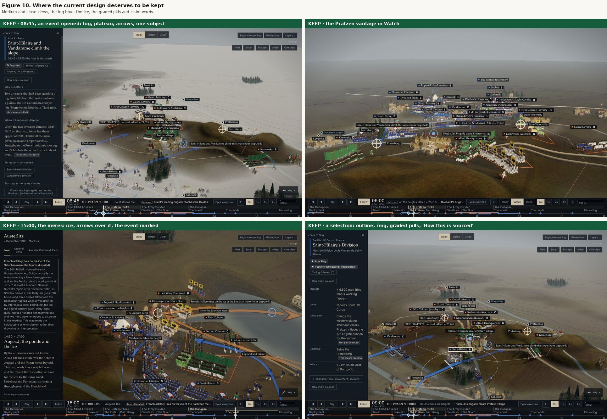
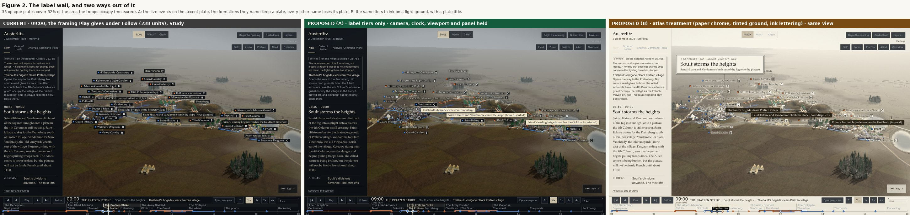
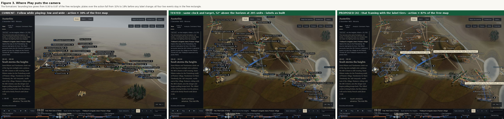
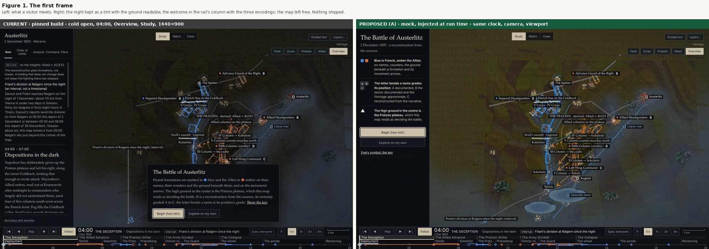
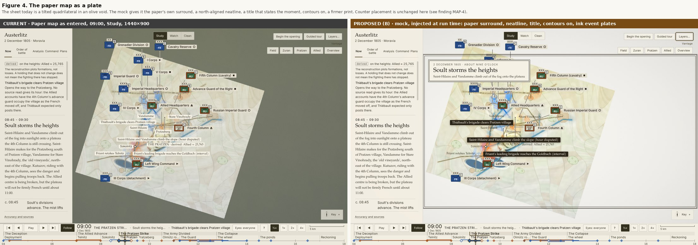
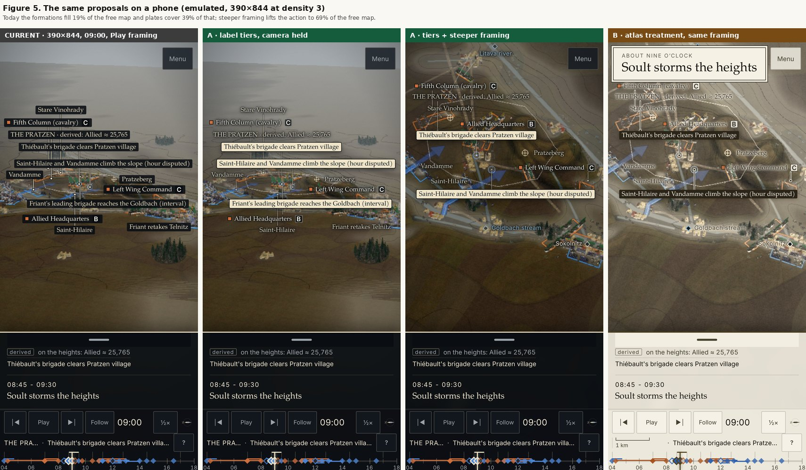
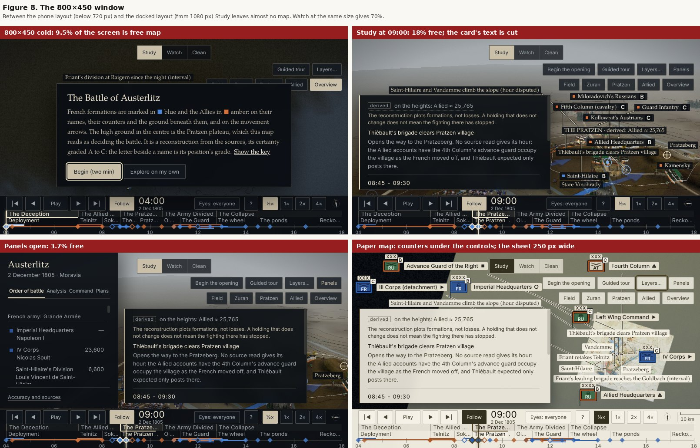
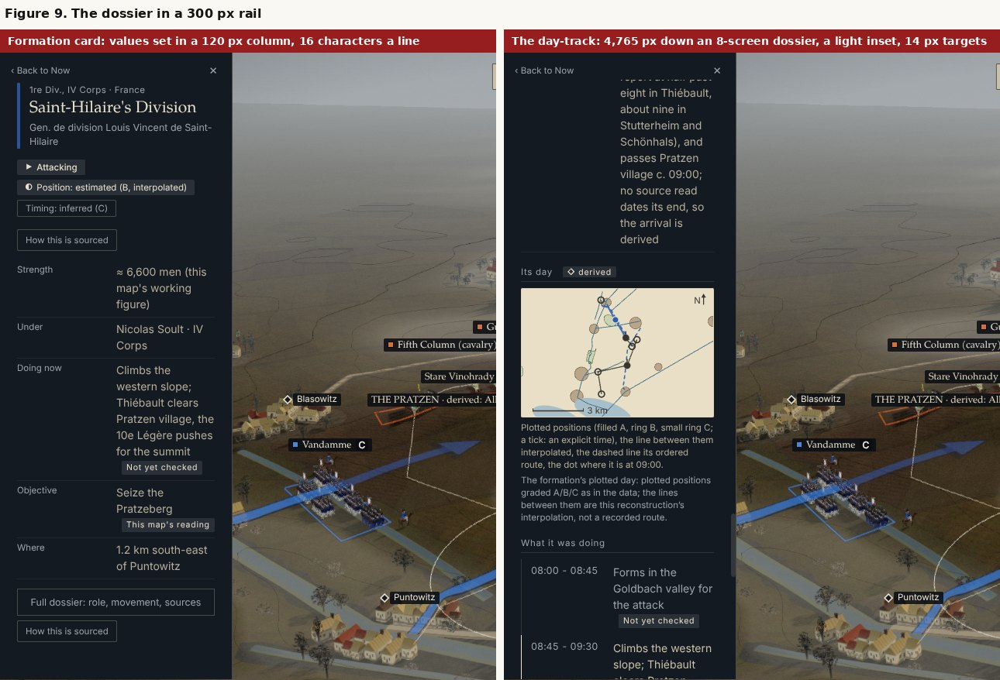
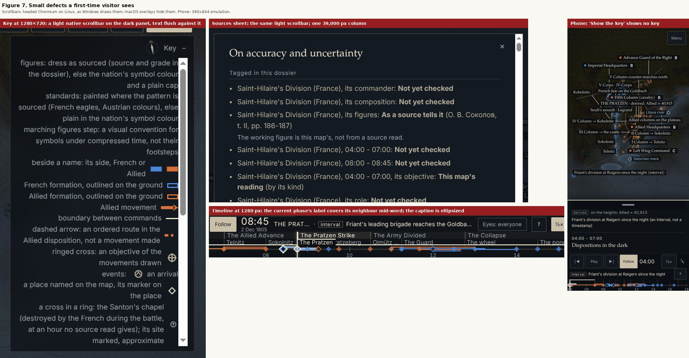

# Austerlitz Command Map: UI/UX, cartography and art-direction audit

Independent audit, 14 November 2026. No production source, branch, PR or deployment was changed. Probes and prototypes are temporary and are packaged with this report under `docs/ux-art-audit/evidence/`.

| | |
|---|---|
| Repository and commit | `billybobbyboo/Austerlitz` at `5382a601dcb6d1af1a7e4b67596a63b3e4029feb` (merge of PR #109), verified |
| Build | `austerlitz-command-map.html`, 3,037,848 bytes, SHA-256 `2275638094e38473fc413e858c5a2f0a93b2bc202e917353e89709daf9ea547d`, verified |
| Published page | Fetched 14 November 2026: byte-identical to the pinned build. All testing ran on a local copy served over HTTP |
| Browser | Chromium 153.0.8010.12 through Playwright 1.63.0 (the pre-installed pair; the project pins 1.56.0). three.js r128 served from a local copy that matches the page's integrity hash |
| Renderer | Software WebGL only: Mesa llvmpipe (headed, under Xvfb) for almost every capture, SwiftShader for the first cold loads. About 1 to 5 frames a second |
| Owner screenshots or recordings | None were attached |

Because the renderer was software, **nothing here is a claim about frame rate or real-time feel**. Layout, composition, interaction and label measurements are valid. Pacing statements are derived from the code's constants and marked as such.

## 1. Verdict

At medium range and in daylight this is already a distinctive piece of work. The 08:45 frame, with valley fog on the Goldbach, the plateau standing out of it and two blue arrows climbing, is a better picture of Austerlitz than most printed atlases manage. The integrity language (side colours, the A/B/C badge, claim words, "derived", "hour disputed") is the product's real identity and it is carried consistently.

The weakness is composition. The map layer treats every label as equally important and gives each an opaque black plate. The camera that Play chooses stands low and far back. Together they produce the frame most visitors will actually watch: a thin band of troops under a wall of black rectangles, with haze above and empty ground below. The first frame has a different problem: it is a near-black night scene with a paragraph of text over the battlefield.

So the art direction is strong in its parts and unresolved as a whole. The fixes are mostly rules (label priority, camera framing, panel placement), not new art.

### The three changes I would make first

1. **Give the map layer three label tiers.** The live event gets the one filled accent plate. The formations that event names keep a plate. Every other name loses its plate and is set with a halo. Tested as a prototype on matched scenes (Figure 2). No assets, no transfer cost.
2. **Reframe Follow during Play.** Look down at about 50 to 55 degrees from about 200 units, where it now looks along the phase's shallow authored direction from 230 to 300 units. On the same clock and target this raised the area the formations occupy from 30% to 87% of the free map and cut the plates covering them from 32% to 18% before any label change (Figure 3). It needs a frame-time check on the phone before it ships.
3. **Repair the first minute.** Move the welcome out of the middle of the map and make it show the three encodings as three rows. Lift the 04:00 light so the ground reads. Make "Show the key" actually show a key on every layout: on a phone and on windows under 1080 px wide it currently closes the card and shows nothing.

### Why someone might still struggle

On a desktop:
- The first frame is dark and wordy, and the meaning of A, B and C as separate letters is never stated in one place at first use.
- During Play the action is small and partly hidden by label plates. When the clock pauses or is scrubbed, the view snaps to a phase view that can leave the live event off screen.
- A formation's full dossier is about eight screens long in a 300 px column, with its best feature, the day-track, near the bottom.
- In a small window (800 × 450) Study leaves 18% of the screen for the map.

On a phone:
- A tap on the time rail usually lands on an event marker. It opens an event sheet over two thirds of the screen where a clock change was wanted.
- "Show the key" is a dead end.
- During Play the formations fill about a fifth of the visible map and label plates cover 27% to 63% of that.
- "Landscape with counters" stacks a dozen counters over the whole field at the opening hour.

## 2. What to keep

These are earned and should be protected by every change below (Figure 10).

- **The medium-range daylight landscape.** The fog hour, the plateau's silhouette, the toy-soldier blocks with their standards, the villages.
- **The meres in the afternoon.** Ice, shore, the amber arrows over the water and the event marked on the ice (15:00, close view) is the second-best frame in the product.
- **The integrity vocabulary.** Side colour squares on names, the grade badge, pills such as "Position: estimated (B, interpolated)", the claim words, "derived" tags, "interval, not a timestamp". They are legible and they are everywhere a decision is made.
- **"How this is sourced" at the head of every dossier**, and the way the sources sheet opens on that dossier's own statements. Closing it returns focus to the button with the scroll position kept (verified from the dossier's head and foot).
- **The single timeline.** Acts, phases, the rail as a slider, event markers and interval bars on one axis. The tooltip on a marker is exactly right.
- **Study, Watch and Clean as three distinct jobs.** Clean in particular is a good, honest "just the model" view.
- **Keyboard and touch paths.** The tab order is logical, the slider keys work, a focused place name that the layer had dropped is drawn at once, target sizes on the phone are 44 px, and the speed control becomes one cycling button.
- **Forced colours and the 320 px reflow.** Both hold up (section 7).
- **The opening.** Four steps to the same four moments is the right length. Step 2 lands on the best frame.

## 3. Art direction, frame by frame

**Focal point.** At medium range there is one: the plateau and the arrows. During Play and at the Overview there is none. In Watch after Play at 09:13 the top 44% of a 1440 × 900 frame is haze, the bottom third is empty ground, and all 31 formations stand in a band holding 19% of the canvas (Figure 6, right).

**Hierarchy.** Chrome hierarchy is good. Map hierarchy is flat. Place names, formation names, event titles, derived readings and plan labels all use the same black plate at 88% opacity. Only the typeface differs (serif for events, small sans for places). The eye cannot tell what is happening now from what is merely there.

**Silhouette and depth.** Close and medium views have real depth: fog below, dark conifers, lit roofs. The Overview has none. Seen from above, the relief barely reads and the model ends in nested hard-edged rectangles where land cover, detail and haze stop at the data frame (Figure 6, left). Seen here on software rendering in every Overview capture; confirm on a GPU.

**Terrain and lighting.** The computed sun and the single light table are a strength from about 08:00 to 16:00. At 04:00, 16:30 and 18:00 the scene is too dark to read as a map. The night light is already a design light (decision 71), so lifting it is an art choice and overclaims nothing.

**Fog and atmosphere.** The valley fog is the best atmospheric device in the product and it is tied to the model. The distance haze is heavier than it needs to be at the Follow distance and flattens the far half of the field.

**Land cover.** Fields, meadow and wood are distinguishable close up. At the Overview they collapse into brown. Roads and streams are flat, wide, hard-edged ribbons. They are acceptable at range and crude close up.

**Labels against terrain.** This is the main problem, measured in section 5 (UA-01). At 09:00 under Follow, 33 plates cover 15% of the free map and 32% of the area the formations occupy. On a phone the second figure reaches 63%.

**Colour and type.** The blue and amber pair works on both grounds. The serif for titles and prose and the sans for controls are well chosen. The small sizes are overused: 10.5, 11.5 and 12.5 px carry most of the rail. Decision 311 (a) kept 11.5 px; I would still raise rail body text to 13 px and keep the small sizes for tags.

**Panel density.** The rail's Now tab opens with two "derived" notes in small sans before the phase title. The title, which is the thing a visitor wants, is the third block down.

**Map furniture.** The scale bar and compass are small and correct. The top right holds eight buttons in two rows ("Begin the opening", "Guided tour", "Layers…", then five vantages under a faint "Vantage" label). They compete with the map's most visible corner.

**Rhythm.** Derived from the code, not observed in real time: at the default ½× the clock runs 5 battle minutes a second (`MIN_PER_SEC=10`, `app.js:3292`), with a 1.5 s hold at each of 21 event starts. The whole day takes about three and a half minutes. The Pratzen assault, 08:45 to 09:30, takes about 9 seconds of motion plus four holds. That may be too brisk for the slowest speed. It needs a real-time recording to judge (section 9).

**The landscape as reconstruction.** Convincing at eye-catching moments, honest about symbol scale in its key. The oversized standards dominate close views, by design.

**The paper map as a working atlas.** Not yet. As entered it is a tilted sheet floating in an olive void. Corps counters are pushed off the sheet on leader lines, there are no place names until the visitor zooms (decision 302 (b)), and the sheet has no border, title or margin. Zoomed in, it becomes sparse: wide flat ribbons, circles for villages, almost nothing new to read. It has the data of an atlas plate and none of the furniture.

**Hierarchy by zoom.** Overview: counters or corps names only would be right; today it shows about 20 division names and event titles. Medium: correct content, wrong weighting. Close: names thin out well; arrows become opaque slabs across villages.

**Telling things apart at a glance.**

| Thing | Today | Reads at a glance? |
|---|---|---|
| Selected formation | Thin cream outline on its name, a thin ring on the ground | At medium range yes, at the Overview no |
| Live event | Serif title on the same black plate as everything else, plus a small glyph | No |
| Planned route | Dashed line or heavy plan arrow | Yes |
| Contextual label | Black plate | Indistinguishable from the above |

## 4. Two directions on the same scenes

Both were built as run-time prototypes injected into the pinned page (`ux-art-audit/evidence/probes/treat.js`). Camera, clock, viewport and open panel are held constant within each comparison. The prototypes restyle the labels the app had already placed. They do not re-run label placement, so a few collisions in the mock frames would not survive a real implementation.

### Direction A, "Quiet plates": a refinement of the current identity

- **Label tiers.** Tier 1, a live event (weight above 0.3 in `liveEvents`): filled accent plate (`#EFE4C8` on `#101720`), 13.5 px serif. Tier 2, a formation named by a live event, or the selection: keeps the dark plate, with a 1 px accent keyline. Tier 3, everything else: no plate, the label ink with a dark halo.
- **Follow framing.** 50 to 55 degrees above the horizon at about 200 units.
- **First frame.** The night kept as a blue tint with the ground readable. The welcome moved into the rail's column as a title, three encoding rows and two buttons.
- **Unchanged.** Tokens, type, dark chrome, the paper map.

What it buys: the live event becomes the one bright thing on the map; the troops and ground show through; the first frame explains itself.

What it costs: halo text is weaker than plated text over pale fog. Two names over the fog in the mock are faint. A shipped version must measure contrast as rendered over the lightest ground and may need the existing far plate (`sym.plate.far`, 0.64) for names over fog only. It reopens decisions 284 (b) and 263 (a).

What I would remove: the opaque plate as the default; the act name from the caption when space is short; the two "derived" notes from the top of the Now tab (moved below the title).

### Direction B, "The plate": an atlas treatment

- **Paper map.** The sheet's surround in the paper's own tone, a north-aligned double neatline around the free map, a title cartouche that states the moment, contours on by default, a firmer print, live events on dark ink plates.
- **Landscape.** Light chrome, a lifted and desaturated ground, ink lettering with a paper halo, the same cartouche.

What it buys: on the paper map, a great deal. The sheet stops looking like a debug view and starts looking like a plate from an atlas, and the cartouche gives every screenshot a caption. On the landscape it buys daylight legibility and a single light identity.

What it costs: on the landscape, the mood. The dark ground is what makes fog, smoke and the side colours work. On a light ground the blue and amber lose separation and the figures wash out. Every interface colour would need re-verifying across the 57 contrast states. The mock's canvas filter would also be a real compositing cost on a phone. A shipped version would have to fold the grade into the existing post pass.

What I would remove: the olive apron on the paper map; the leader-line ring of corps counters as the entry state.

### The choice

**A on the landscape, B on the paper map.** Ship A's label tiers and framing everywhere, because they fix measured defects and are independent of theme. Adopt B for the paper map only, including the cartouche. Do not ship B's light landscape. The cartouche is worth trying in Watch and in the opening on the dark landscape too, as the place where the phase title lives.

## 5. Findings register

Kinds: **defect** (confirmed on the pinned build), **opportunity** (a design change, tested where noted), **lead** (not verified here). Impact is the expected effect on a visitor.

| ID | Finding | Kind | Impact | Prior ID |
|---|---|---|---|---|
| UA-01 | Opaque label plates cover the action | Defect and opportunity (tested) | High | CL-MAP-15, CL-MAP-17 (kept) |
| UA-02 | Follow frames the action small and low; a pause or scrub can put the live event off screen | Opportunity (tested) | High | Decision 78 |
| UA-03 | The first frame is dark and the welcome covers the field | Opportunity (tested) | High | CL-UX-11 (fixed in part) |
| UA-04 | A, B and C are never defined together at first use | Defect | Medium | CL-UX-11 |
| UA-05 | "Show the key" shows no key below 1080 px wide or at 430 px tall or less | Defect | High on phone | CL-MAP-03 (fixed elsewhere) |
| UA-06 | Event markers take presses meant for the rail | Defect | High on phone | CL-UX-03 (carried) |
| UA-07 | Study at 800 × 450 leaves 18% of the screen for the map | Defect | Medium | CL-MAP-13 |
| UA-08 | The paper map lacks atlas furniture and enters as a tilted sheet in a void | Opportunity (tested) | Medium | CL-MAP-05 (kept) |
| UA-09 | The Overview shows the model's edge and little relief | Opportunity | Medium | None found |
| UA-10 | The full dossier is 8 screens in 300 px; the day-track sits at the bottom | Opportunity | Medium | None found |
| UA-11 | The sources sheet is one 39,000 px column | Opportunity | Medium | CL-UX-21 |
| UA-12 | Light system scrollbars on dark panels | Defect (platform-dependent) | Low to medium | None found |
| UA-13 | The current phase's label overprints its neighbour; the caption truncates the act name | Defect | Low | CL-MAP-06 |
| UA-14 | "Landscape with counters" buries the field on a phone | Defect | Medium on phone | CL-MAP-07 (carried) |
| UA-15 | Watch shows the same label density as Study | Opportunity | Medium | None found |
| UA-16 | The Now tab leads with derived notes, not the phase title | Opportunity | Low to medium | None found |
| UA-17 | Coincident event markers hide one another | Defect | Low | Decision 167 |
| UA-18 | One Tab stop in each cycle lands on the page body | Lead | Low | CL-UX-20 |
| UA-19 | ½× may be too fast to be the slowest speed | Lead (derived from code) | Medium | Decision 74 |
| UA-20 | Close-up ribbons and arrows are crude | Opportunity | Low | CL-VIS-05 |
| UA-21 | A press on a day-track anchor during Play can be lost | Lead (not reproducible here) | Medium | Closing pass, finding 1 |
| UA-22 | Plans view mixes plan labels with the current hour's labels | Opportunity | Low | CL-MAP-11 |

### UA-01. Opaque label plates cover the action

- **Where:** landscape, Study and Watch, all sizes; worst during Play and on a phone.
- **Expected:** the live event and its formations stand out; other names recede.
- **Observed:** every label has the same `rgba(10,14,18,.88)` plate. Desktop Study under Follow, 08:55 to 09:10: 30 to 35 plates covering 15% of the free map and 28% to 32% of the formations' bounding box. Watch: the same. Phone: 10 to 15 plates covering 27% to 48% of that box, 63% at one sample.
- **Evidence:** Figure 2; `ux-art-audit/evidence/logs/j9f-all.json`; `ux-art-audit/evidence/captures/j2-02-play-*.jpg`; `ux-art-audit/evidence/captures/j9-G3-phone-play-*.jpg`.
- **Cause:** one plate token for all map text (`tokens.js`, `sym.plate`), chosen so any text passes AA over any ground. Decisions 284 (b) and 263 (a) kept the wall and lightened only far names.
- **Recommendation:** Direction A's three tiers. In Watch, drop tier 3 for formations entirely while playing.
- **Check:** during a scripted Play from 08:30 to 09:30 at 1440 × 900 and at 390 × 844, plates with a fill cover at most 12% of the formations' bounding box in every sample; every tier 3 label measures at least 4.5:1 as rendered against its local ground, including over fog; the label pass stays under its 8 ms limit. A cosmetic fix would lower plate opacity and fail the contrast half.

### UA-02. Follow frames the action small and low

- **Where:** landscape during Play; also every pause, scrub and marker click.
- **Expected:** the clock, caption, camera and labels show the same event.
- **Observed:** under Follow the eye settles 230 to 255 units out along the phase's shallow direction. The formations' box is 27% to 31% of the free map in Study and 17% to 19% in Watch. When the clock stops, the phase view applies. At 09:00 that view holds 9 of 31 formations and leaves 2 of the 4 live events outside the free map. At 08:30 the one live event is off the left edge in Study.
- **Evidence:** Figure 3, Figure 6; `ux-art-audit/evidence/logs/j9f-all.json`.
- **Cause:** `FOLLOW={…DMIN:230, DMAX:300}` and `followGoal` taking the phase's direction (`app.js:9516` to `9525`). The code comment records why: at 140 to 200 units the label layer dropped too many names. The label system set the camera distance.
- **Recommendation:** after UA-01, change Follow to an elevation of 50 to 55 degrees and a distance near 200 units (`K` and `D0` retuned). When Play stops, keep the Follow view. Reserve phase views for phase buttons.
- **Tested:** at 09:00, 52 degrees and 205 units: box 87% of the free map, plates over the action 18%, all 4 live events inside, 28 of 31 formations inside. On the phone at 55 degrees and 300 units the box reached 69% but 2 of 4 live events fell outside, so the phone needs a larger distance than I tried.
- **Check:** over the day at ½×, every live event with weight above 0.3 is inside the free map in at least 90% of minutes; the formations' box is at least 50% of the free map on desktop and 40% on a phone; screen speed stays within 150 px/s; the camera floor holds; frame time on the owner's iPhone route is no worse than the Stage 7 run. A cosmetic fix would only shorten the distance and fail the event-inside test.
- **Dependency:** closer views put more blocks on the rich kit (`KLOD`), so triangles rise. This needs the separate performance audit's device route.

### UA-03. The first frame

- **Where:** cold load, all sizes.
- **Expected:** a visitor sees a battlefield and knows where to look.
- **Observed:** 04:00 at the Overview is near black. The card sits centred at the bottom of the map over the Goldbach's southern half and reads as one paragraph. At 1280 × 720 the free map is 26% of the screen while the card is open.
- **Evidence:** Figure 1; `ux-art-audit/evidence/captures/j1-d1440-00-cold.jpg`; `ux-art-audit/evidence/captures/j6-l1280-01-cold.jpg`.
- **Cause:** `LIGHT.predawn` (sun 0.26, `app.js:160`); `#firstrun` centred over the map (`style.css:660`).
- **Recommendation:** from 1080 px, put the welcome in the rail's column, with the dispatch behind it. Use three rows with samples (colour, grade letters, the plateau), then the two buttons, then "Every symbol: the key". On a phone, use a bottom sheet of the same rows. Lift the predawn light to roughly sun 0.6 and hemisphere 1.25 with a cooler grade, keeping the hour.
- **Check:** the harness's first-run unobstructed fraction rises to at least 0.70 at 1600 × 900 and 1366 × 768 (the present baselines are 0.625 and 0.546); median luminance of the battle area at 04:00 at least doubles; text contrast in all 57 states still passes.
- **Owner decision:** whether 04:00 may be lit this way, and whether decision 113 (the dispatch visible beside the card) still stands.

### UA-04. A, B and C are never defined together

- **Where:** card, key, Layers panel, dossier.
- **Observed:** the card says certainty is "graded A to C". The key's only grade row is "position approximate (B, C) · reported only (?)". The Layers panel says "A its footprint, B its frontage doubled, C a zone". The three sentences that define the letters (`CONF_TEXT`, `app.js:8259`) appear only inside a dossier. Timing uses the same letters on a different scale.
- **Test of the brief's question:** from the interface alone a visitor can explain the colours at once, the counters only from the key in a counters view, and A/B/C only after opening a dossier.
- **Recommendation:** one row per grade in the key and in the welcome, using `CONF_TEXT`'s existing words. No data change.
- **Check:** with the key open, the three definitions are on screen in every layout.

### UA-05. "Show the key" shows no key

- **Where:** any window under 1080 px wide, or 430 px tall or less. Confirmed at 390 × 844 and 800 × 450.
- **Expected:** the key.
- **Observed:** the card closes, focus goes to Play and nothing else changes. The key exists only inside the "?" sheet on these layouts.
- **Evidence:** Figure 7 (right); `ux-art-audit/evidence/logs/measurements.md`: after the tap the legend's display is `none` and focus is on Play.
- **Cause:** the handler sets `ML.legendOpen=true` and focuses the legend toggle (`app.js:7581`), while `.legend{display:none}` applies at these sizes (`style.css:597`, `638`).
- **Recommendation:** where the legend is not displayed, open the "?" sheet scrolled to "The map key".
- **Check:** in every harness viewport, activating the link leaves an element containing the key's rows visible and focused within 500 ms. This is the "key visibility after activation" measure.

### UA-06. Event markers take presses meant for the rail

- **Where:** timeline, mostly on a phone.
- **Observed on the phone:** a hit test across the 374 px rail found a marker under 66% of points at mid height and 78% near the top. A tap aimed at 09:00 opened the 09:15 event's sheet and left a 288 × 232 px map.
- **Observed on desktop:** with the playhead under a marker, a 200 px mouse drag in 2 px moves scrubs; in 8, 16 or 33 px moves it does nothing. A press that slips 9 px on a marker is taken as a 5-minute scrub.
- **Evidence:** `ux-art-audit/evidence/captures/j4-09-paper-0900.jpg`; `ux-art-audit/evidence/logs/measurements.md` (rail hit test, drags).
- **Cause:** 11 px markers sit on the rail; `RAIL_SLOP=6` (`app.js:7911`) is tested only while the pointer is over the marker, and a mouse has no implicit capture. The closing pass records this as carried (CL-UX-03). It found 8 px moves scrubbing; here they did not.
- **Recommendation:** call `setPointerCapture` on the marker at press so every move reaches the slop test. On touch layouts, give markers their own row above the rail so the rail's 24 px is all rail.
- **Check:** from the playhead under any marker, a 200 px drag in single moves of 2, 8, 16 and 33 px scrubs to the time under the release; on a 390 px phone, a tap anywhere in the rail's lower 16 px changes the clock and opens no sheet.

### UA-07. Study at 800 × 450

- **Observed:** free map 9.5% of the screen at cold load, 18% in Study, 7.7% with Layers open, 3.7% with Panels open. The dispatch card shows four lines of text before it scrolls. On the paper map the counters sit under the top controls. Watch at the same size gives 70%.
- **Evidence:** Figure 8.
- **Cause:** between 720 and 1079 px the layout is the desktop's with a floating 440 px card, and the timeline keeps its full height.
- **Recommendation:** extend the phone's bottom-sheet pattern up to 1079 px wide when the window is under about 600 px tall, with the card collapsed to its title line.
- **Check:** free map at least 45% in Study at 800 × 450 and 1024 × 600, no clipped text, no control overlapping a map item.

### UA-08. The paper map

- **Observed:** described in section 3. As entered at 1440 × 900 the sheet is tilted about 20 degrees in an olive surround; corps counters ring it on leader lines; no place names.
- **Recommendation:** Direction B's plate (Figure 4): paper surround (the apron's colour in this mode), neatline, cartouche, contours on, place names at entry for the dozen villages the narrative uses.
- **Check:** as entered at the three desktop sizes, at least 10 of the 12 place names are drawn; no counter stands outside the neatline; scale and north stay within their present tolerances.
- **Owner decision:** reopens decision 302 (b).

### UA-09. The Overview

- **Observed:** Figure 6, left. Hard-edged nested rectangles where the detailed ground ends; relief not legible from above; two thirds of the frame is unlit apron.
- **Recommendation:** feather the ground's edge into the apron over the outer 8% of the model; add a far-distance relief tint so the plateau reads as high ground; fit the Overview tighter to the day's battle.
- **Check:** along a pixel row crossing the model's edge, no luminance step above a set threshold; the plateau's mean luminance differs from the valley's by a set margin at the Overview.
- **Dependency:** ground shader work in `world.js`. Hand to the engine audit for cost.

### UA-10. The dossier

- **Observed:** the docked drawer is 300 px wide. The summary card sets values in a 120 px column at about 16 characters a line. Saint-Hilaire's full dossier is 6,345 px tall in a 774 px viewport (8.2 screens). The day-track starts 4,765 px down, is drawn on a light ground inside the dark panel, and its anchors are 14 px targets.
- **Evidence:** Figure 9.
- **Recommendation:** put the day-track directly under the header pills. Split the dossier into four in-panel sections with a sticky index: Now, Day, Strength and dress, Sources. Stack label over value under 340 px. Draw the day-track on the panel's ground in the dark theme. Give anchors a 24 px hit area.
- **Check:** the day-track's top is within the first viewport of the full dossier at 1280 × 720; no value column narrower than 200 px; anchor hit areas at least 24 × 24 px.

### UA-11. The sources sheet

- **Observed:** 104,457 characters in one 543 px column, 38,972 px tall, with no index or search. Its opening section, "Tagged in this dossier", is good.
- **Recommendation:** a sticky section index, collapsible sections, and a filter box for the claims index.
- **Check:** any section reachable in two activations; focus return unchanged.

### UA-12. Light scrollbars on dark panels

- **Where:** the key, the sources sheet, the Layers panel and the welcome card when they scroll.
- **Observed:** a white 15 px system scrollbar on the dark panel, with right-aligned key text flush against it (Figure 7, left).
- **Cause:** only the rail, drawer and dispatch have scrollbar styles (`style.css:46`, `166`, `579`); the page sets no `color-scheme`.
- **Recommendation:** `color-scheme: dark` for the dark theme and `light` for the paper theme, or `scrollbar-color` on those containers, plus 8 px of inline-end padding in the key.
- **Check:** in a screenshot of each scrolling panel, the scrollbar track's luminance is within a set distance of the panel's.
- **Coverage:** seen on Linux Chromium. Windows should match; macOS overlay scrollbars hide it. Not verified on either.

### UA-13. Timeline labels

- **Observed:** at 1280 and 1440 px the current phase's label is drawn unclipped over its neighbour, producing "The Pratzen ratzeberg" (Figure 7). The caption truncates the act to "THE PRAT…" and "THE COLLAP…" while showing the event in full.
- **Cause:** `.step[aria-current="true"] .step-l{overflow:visible}` (`style.css:290`) with no background.
- **Recommendation:** give the current label the timeline's background and 4 px of padding so it covers cleanly. In the caption, drop the act before truncating it; the act band already names it.
- **Check:** zero intersecting text boxes in the phase row at 1024, 1280 and 1440 px; zero ellipsized act names in the caption.

### UA-14. Counters on a phone

- **Observed:** at 04:00 in "Landscape with counters" twelve full counters with names cover the field (`ux-art-audit/evidence/captures/j4-07-counters.jpg`). The closing pass carries the motion side of this as CL-MAP-07.
- **Recommendation:** on a phone show the counter frame without its name plate, and the name only for the selection and the live event's formations.
- **Check:** counters and their plates cover at most 25% of the free map at 04:00 and 09:00 on a 390 px phone.

### UA-15. Watch

- **Observed:** Watch removes panels but keeps Study's label set.
- **Recommendation:** in Watch show tier 1 and tier 2 only and move the phase title into a cartouche. This makes Watch visibly different from Study and is the cheapest way to a "cinematic" mode.
- **Check:** in Watch during Play, at most 12 labels are drawn at 1440 × 900 and every live event's named formations are among them.

### UA-16. The Now tab's order

- **Observed:** derived note, derived explanation, live event, then the phase time and title.
- **Recommendation:** phase time and title first, then the lede, then the live event, then derived readings as one compact row with their tags.
- **Check:** the phase title's top is within 150 px of the tab bar.

### UA-17 to UA-22, briefly

- **UA-17.** Two events that start at the same minute (07:00, 08:45, 11:00, 11:15) draw markers at the same x. Only the top one takes a pointer. Offset coincident markers vertically. Check: every marker has at least 8 px of its own hit area.
- **UA-18.** In each Tab cycle one stop reported the page body as the active element, between the last place name and "Study". Not investigated. Check on real hardware with a visible focus indicator.
- **UA-19.** See "Rhythm" in section 3. If a real-time recording confirms it, add ¼× or re-base the four speeds. Owner decision (decision 74).
- **UA-20.** At close range roads and streams are flat bands with polyline corners and movement arrows are opaque slabs over villages. Soften ribbon edges and fade arrow fill within about 60 units of the eye. Low priority.
- **UA-21.** The closing pass found presses on a day-track anchor lost during Play when a repaint falls between press and release. Here, at about one frame a second, 8 of 8 presses were taken at 0, 100 and 250 ms holds, which says nothing about a 60 Hz device. When it works, the press stops Play and moves the clock, which is the right behaviour.
- **UA-22.** With "Both" plans on, plan labels and the current hour's formation and event labels are drawn together over thick crossing arrows. In Plans, suppress the current hour's labels.

## 6. Recommended direction and roadmap

Direction: **A on the landscape, B on the paper map**, in this order. Effort is rough: S is a day or two, M up to a week, L more.

| PR | Scope | Findings | Effort | Depends on |
|---|---|---|---|---|
| 1 | Repairs: key link, scrollbars, timeline labels, marker capture and phone marker row | UA-05, 06, 12, 13, 17 | S | Nothing |
| 2 | Label tiers on the landscape; stricter set in Watch | UA-01, 15 | M | Owner: decisions 284 (b), 263 (a) |
| 3 | Follow framing; keep the view when Play stops | UA-02 | M | PR 2; device frame times |
| 4 | First frame: welcome in the rail column, grade rows, predawn light | UA-03, 04 | S to M | Owner: decisions 71, 113 |
| 5 | Paper plate: surround, neatline, cartouche, names at entry | UA-08 | M | Owner: decision 302 (b) |
| 6 | Mid-width layout and phone counters | UA-07, 14 | M | PR 2 |
| 7 | Reading: dossier sections, day-track first, sources index, Now tab order | UA-10, 11, 16 | M | Nothing |
| 8 | Overview edge and relief | UA-09 | M to L | Engine audit |
| 9 | Optional art and sound (section 7) | UA-20 | L | Owner decisions |

Why this order: PR 1 removes dead ends at almost no risk. PR 2 must precede PR 3 because the label layer is what forced the camera back. PR 4 is independent and has the largest first-impression effect, so it can run in parallel with 2 and 3. PRs 5 to 7 are self-contained. PR 8 touches the ground shader and should wait for cost numbers.

Acceptance criteria, beyond each finding's own check:

- **Suites.** `npm test`, `check:data`, `check:chronology`, `check:contrast` and `check:selftest` pass. No assertion loosened. Any moved baseline is listed with its before and after.
- **No data touched.** `check:data` stays byte-identical in every PR here. Grades, claims and geography are presentation inputs only.
- **Label continuity during Play.** The existing `MOTION.LONG` bar holds, and the share of frames in which a live event's named formations are drawn rises to at least 90% on desktop (the closing pass measures 72% to 77%).
- **Unobstructed map area.** First run at least 0.70; Study at 800 × 450 at least 0.45; no existing baseline lowered.
- **Focus return.** Unchanged: closing a sheet or dossier returns focus to its opener, in view.
- **Text clipping.** Zero ellipsized act names; zero overlapping phase labels.
- **Device frame times.** For PRs 3 and 8, the owner's desktop and iPhone routes, matched against the Stage 7 runs.
- **Reduced motion and forced colours.** Re-run section 8's spot checks; tier 1 plates must keep a border in forced colours.

Preserve: everything in section 2. Remove: the default opaque plate, the centred welcome card, the olive apron on the paper map, the truncated act in the caption.

## 7. Blender, Unreal Engine 5, FL Studio

None of the three improves UI or UX. The gains above come from rules. Each tool could add something narrower.

**Blender: yes, as an offline bench.** Three uses that fit the single-file model:
- Bake ambient occlusion into the vertex colours of the existing building and tree kit. No textures, no draw calls, a few kilobytes.
- Model the four to six landmarks that have sourced forms (the Sokolnitz castle, the Pratzen church, the Austerlitz château and garden) to about 1,500 triangles each, exported as quantised arrays. Roughly 6 to 10 KB each after compression, under 2% of the file. Anything whose 1805 form is unknown stays a mark, as decision 282 (a) has it.
- Render a multi-directional hillshade of the project's own relief model for the paper map, about 60 to 90 KB as an embedded image beside the 666 KB of textures already there.

Phone: stay within the 1.62 million triangle budget and re-run the device route. Reduced motion: unaffected. Every modelled form needs a claim in `appearance.js`, which is a data task and outside this audit.

**Unreal Engine 5: no, not for the product.** UE5 has no supported browser target. Putting it in front of visitors means pixel streaming from GPU servers, which ends the single HTML file, GitHub Pages hosting, offline copies, the DOM label layer and its keyboard and screen-reader paths. Its realistic use is an offline-rendered trailer or stills hosted beside the map. Photoreal troops would also assert uniform and terrain detail the sources do not settle, which conflicts with the project's first priority. If you want cinematic camera moves, script them in the existing scene.

**FL Studio (or any audio workstation): optional, last.** It could author a restrained sound layer: a wind bed, distant guns cued by the same events that drive smoke, and quiet interface ticks. Rough cost: a 60 to 90 s loop at 48 kbps mono is 400 to 550 KB, plus about 100 KB of one-shots. Embedded as base64 that adds about 0.8 MB, a quarter of the file; fetched separately it changes the delivery model. It must be off by default, start only from a labelled control, stop with Pause and be described in the key as a design convention. All of that is an owner decision. I would not start it before PRs 1 to 5.

## 8. What was tested

Real input (clicks, taps, keys, drags, wheel) unless marked programmatic. Programmatic steps used the app's own `setClock`, `setPresentation`, `setMode` and `select`.

| Journey or check | Viewport | How | Result |
|---|---|---|---|
| 1. Arrive cold: card, key, opening to its end, Explore | 1440 × 900 | Real input | Completed. Card focus order: Begin, Explore, Show the key |
| 2. Follow the action: rail click, Play ½× and 4×, pause, scrub, Follow off and on, marker drags | 1440 × 900 | Real input, video | Completed. Video is at software frame rates |
| 3. Evidence: event, card, full dossier, day-track anchors paused and playing, sources and back, Whose eyes?, Plans, a theme, tour stop 1 | 1440 × 900 | Real input; selection programmatic in one recheck | Completed |
| 4. Phone: card, key, Menu, Layers, three grounds, rail tap, Play, speed, dossier, rotate and back | 390 × 844, density 3, touch, iPhone user agent | Real taps | Completed in emulation |
| 5. Visual range: 04:00, 07:00, 09:00, 10:00, 14:45, 15:00, 16:30, 18:00; five vantages; Study, Watch, Clean; paper map at five zooms; counters | 1440 × 900 | Programmatic clock and mode; real vantage clicks and wheel | Completed |
| Short laptop | 1280 × 720 | Real input | Free map 37% in Study with the key open, 81% in Watch |
| Narrow | 800 × 450 | Real input | See UA-07 |
| Reflow | 320 × 256, density 4 | Real input | No horizontal scroll; card, Phase text and Menu work |
| Keyboard only | 1280 × 720 | Keys only | Complete path to a dossier and back; slider keys, ".", ",", "M", "?" work; see UA-18 |
| Reduced motion | 1280 × 720 | Emulated preference | Opening cuts between steps; the camera stayed still across an 8 s sample of Play |
| Forced colours | 1280 × 720 | Emulated | Controls bordered, pressed states visible, map labels readable |
| Carried findings | 1440 × 900 | Real mouse | CL-UX-03 residual reproduced; lost press not reproducible at this frame rate |

Console: no error or warning in any session.

## 9. Not verified, and what would settle it

Not verified here:
- Real-time pacing, smoothness and any frame rate.
- Physical iPhone Safari: pinch, safe areas, address-bar height changes, sheet scrolling, real finger accuracy on the rail, embedded font metrics.
- VoiceOver and NVDA: announcements, dialog names, reading order of the map layer.
- Windows and macOS scrollbars; Firefox and desktop Safari.
- CL-MAP-02 (formations named by a live event hidden): my probe failed to start and I did not re-measure it.
- The eye-level vantage, tour stops 2 to 9, nine of the ten themes, and "Landscape with counters" during Play.
- The Overview's hard edges on a GPU.

Choices that need your judgment:
1. Reopen decisions 284 (b) and 263 (a) for label tiers.
2. Change Follow's distance and angle (decision 78), subject to phone frame times.
3. Light the 04:00 scene as proposed, or keep the dark opening.
4. Move the welcome into the rail column (decision 113).
5. Reopen decision 302 (b) and adopt the paper plate.
6. Add a slower speed (decision 74).
7. Raise rail body text to 13 px (decision 311 (a)).
8. Any Blender landmark work (a data task) and any sound layer (file size or delivery model).

Captures and runs that would settle them:
- **Desktop, real GPU, 1440 × 900, screen recording:** cold load, "Begin", all four opening steps; then Play at ½× from 08:30 to 09:30 in Study and in Watch. Settles pacing (UA-19) and whether the label wall reads as badly in motion as in stills.
- **The same recording with `ux-art-audit/evidence/probes/treat.js` pasted into the console and `__treat.A()` called.** Settles choice 1 in motion.
- **iPhone Safari, portrait, screen recording:** cold load, "Show the key", tap the rail at 09:00, Play to 09:30, open and close a dossier, rotate and back. Settles UA-05 and UA-06 on a real finger.
- **iPhone device route** (`perf-run.html?route=phone`) on a build with Follow at 55 degrees and about 300 to 380 units. Settles choice 2.
- **Windows Chrome or Edge, one screenshot each:** the key open at 1280 × 720 and the sources sheet. Settles UA-12.
- **VoiceOver on iPhone and NVDA on Windows:** the existing `docs/final-stage6-evidence/sr-session.md` script, plus one pass through "Show the key" and one day-track anchor.
- **Desktop GPU, one screenshot:** Overview in Watch at 09:00. Settles UA-09.

## 10. Evidence

Everything is under `docs/ux-art-audit/`. Paths in this report are relative to `docs/`.

- `ux-art-audit/figs/`: the ten annotated figures used above.
- `ux-art-audit/evidence/captures/`: 154 baseline captures, named by journey (`j1` to `j9`), at CSS-pixel size. Phone captures are halved from density 3.
- `ux-art-audit/evidence/mock/`: the prototype frames, current and proposed, for the four matched scenes.
- `ux-art-audit/evidence/video/j2-play-0830-0915-half-speed-software-gl.mp4`: Journey 2's Play, pause and scrub. Software rendering; not a performance record.
- `ux-art-audit/evidence/logs/`: probe output, including the composition measures (`j9f-all.json`).
- `ux-art-audit/evidence/probes/`: every probe, the measurement functions (`metrics.js`), the prototypes (`treat.js`) and the figure composer.

Six captures from the first visual-range run were mislabelled "clean" while showing Study. They were deleted and Clean was re-shot.
