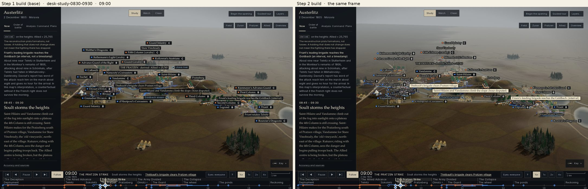
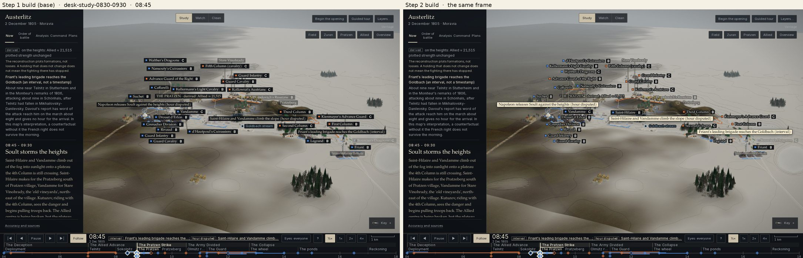

# UI/UX roadmap step 2: the Landscape's label tiers and Watch's label set (UA-01, UA-15)

Evidence for the draft pull request. How each number was taken: [`METHOD.md`](METHOD.md). The runs' records: [`runs/`](runs/) (a summary, a log and
the per-frame values for each run on each build). The matched captures: [`captures/`](captures/).

| | Base (UI/UX step 1, `main` at `72cc626`) | This build |
|---|---|---|
| `austerlitz-command-map.html` | 3,053,167 bytes, md5 `d404045b4544eb03c69fc3c9e3fff044` | **3,071,014 bytes, md5 `07cbcaf32808c430198d55b1b7ed78b7`** |
| SHA-256 | `b06cf04d2919dd094943535b18ee3b92333785e8a7c0cd21eef34d8381530a4b` | `06842ca46dfbdaf6c892de2393b83b5e28c6fe211a180c53244688bfbedaf186` |

**Environment of every number here:** Chromium 141.0.7390.37 (the build Playwright 1.56.0 pins), headless, **software WebGL** (ANGLE on
SwiftShader), Linux, 4 CPU cores. The phone is **Chromium's emulation** (390 x 844, density 3, touch, an iPhone's user agent), not a physical
device. Nothing here is a frame rate. Safari, a real GPU and a real phone were not available in this session.

## 1. The result against the five acceptance points

| # | Target | Result | Met? |
|---|---|---|---|
| 1 | Filled plates over at most 12% of the formations' box in every frame of the 08:30 to 09:30 Play, at 1440 x 900 and 390 x 844, Study and Watch | **1440 x 900:** 30.8% at most (25.0% median) on the base; **13.6% at most (8.6% median)** now in Study, 13.4% (8.7%) in Watch; over 12% in **28 of 548 frames** (08:54.8 to 08:59.3, while four live events' plates and the four formations they name stand at once). **390 x 844:** 44.8% at most (30.8% median) on the base; **35.7% at most (16.2% median)** now; over 12% in 501 of 548 frames. Fallback plates under tier 3 labels: **0** in every frame of every run | **No** on the phone; on the desktop in 520 of 548 frames (section 3) |
| 2 | Tier 3 at 4.5:1 as rendered against its local ground, fog included; the label pass under 8 ms | Against its casing: **7.46:1 at the least over 1,934 tier 3 texts** in 137 drawn frames (the fog of 08:30 to 09:00, 09:00 to 09:30, noon), none below 4.5:1. Against the ground between and round its words (the measure a plated label is held to) it reads lower: section 4. The label pass: **1.5 ms median, 3.9 ms at the 95th percentile** (base 1.5 and 4.6); single passes over 8 ms, 33 of 7,392 over the twelve runs (base 40), with two runs sharing four cores | **Yes by the casing; no by the whole box**: the owner's call (section 4) |
| 3 | The formations a live event names drawn in at least 90% of desktop frames; `MOTION.LONG` preserved | On the Landscape, 08:30 to 09:30: **2,706 of 2,706 (100%)** in Study, base 2,205 of 2,706 (81.5%); 2,752 of 2,752 in Watch, base 84.7%. 11:30 to 13:00: 6,878 of 6,878, base 92.2%. `MOTION.LONG`'s own runs (the Landscape with counters, which step 2 does not touch): 4,833 of 6,322 (76.4%) and 11,869 of 16,010 (74.1%) here, the base's counts exactly (on CI's runner 12,072 of 16,010 on both builds), over its 70% bar | **Yes** on the Landscape (section 5) |
| 4 | Interaction and accessibility through Play, pause, seek, event changes, focus, selection, forced colours, reduced motion, a phone; the comparison cases; #111's behaviour | The live block `ux2` passes every check on this build and fails 561 on the base; the Landscape with counters and the paper map measure the same on both builds in every number; the block `ux1` (step 1's key, rail and markers) passes | **Yes**, in emulation (section 6) |
| 5 | The suites; guarded data byte-identical; existing assertions and baselines kept; the unobstructed-area targets measured | `npm test`, `check:data` (143 of 143 identical), `check:chronology`, `check:contrast`, `check:selftest`: section 7. No limit, ceiling or baseline moved. The unobstructed targets are not met on the base and are unchanged (section 8) | **Yes**; the full `check:visual` passed on CI, not run here (section 7) |

## 2. The runs

| Run (frames) | Build | Filled plates over the formations' box: max / median / frames over 12% | Labels drawn: max / median; on a fill: max | Tier 3 fills | Event-named formations drawn of those in view | Label pass: median / 95th (ms) |
|---|---|---|---|---|---|---|
| 1440 x 900, Study, 08:30 to 09:30 (548) | Step 1 | 30.8% / 25.0% / 545 of 548 | 44 / 32; 44 | 0 | 2205 of 2706 (81.5%) | 1.5 / 4.6 |
|  | **Step 2** | 13.6% / 8.6% / 28 of 548 | 43 / 32; 9 | 0 | 2706 of 2706 (100.0%) | 1.5 / 3.9 |
| 1440 x 900, Watch, 08:30 to 09:30 (548) | Step 1 | 30.8% / 24.9% / 548 of 548 | 47 / 34; 47 | 0 | 2332 of 2752 (84.7%) | 1.3 / 2.9 |
|  | **Step 2** | 13.4% / 8.7% / 28 of 548 | 9 / 7; 9 | 0 | 2752 of 2752 (100.0%) | 1 / 2.5 |
| 390 x 844 (phone), Study, 08:30 to 09:30 (548) | Step 1 | 44.8% / 30.8% / 548 of 548 | 18 / 11; 18 | 0 | 248 of 334 (74.3%) | 0.9 / 2.4 |
|  | **Step 2** | 35.7% / 16.2% / 501 of 548 | 18 / 12; 5 | 0 | 334 of 334 (100.0%) | 0.9 / 2.2 |
| 390 x 844 (phone), Watch, 08:30 to 09:30 (548) | Step 1 | 44.8% / 30.8% / 548 of 548 | 19 / 11; 19 | 0 | 248 of 334 (74.3%) | 0.9 / 2.1 |
|  | **Step 2** | 35.7% / 16.2% / 501 of 548 | 5 / 4; 5 | 0 | 334 of 334 (100.0%) | 0.8 / 1.8 |
| 1440 x 900, Study, 11:30 to 13:00 (728) | Step 1 | 30.0% / 22.9% / 685 of 728 | 42 / 36; 42 | 0 | 6340 of 6878 (92.2%) | 1.3 / 3 |
|  | **Step 2** | 17.9% / 8.6% / 91 of 728 | 43 / 36; 16 | 0 | 6878 of 6878 (100.0%) | 1.3 / 2.9 |
| 1440 x 900, Watch, 11:30 to 13:00 (728) | Step 1 | 26.7% / 22.0% / 670 of 728 | 43 / 38; 43 | 0 | 6437 of 6934 (92.8%) | 1.3 / 2.6 |
|  | **Step 2** | 13.8% / 8.3% / 41 of 728 | 16 / 13; 16 | 0 | 6934 of 6934 (100.0%) | 1.1 / 2.4 |
| 390 x 844 (phone), Study, 11:30 to 13:00 (728) | Step 1 | 51.9% / 37.5% / 716 of 728 | 17 / 11; 17 | 0 | 845 of 1151 (73.4%) | 1.2 / 3 |
|  | **Step 2** | 49.1% / 35.8% / 664 of 728 | 17 / 11; 8 | 0 | 1151 of 1151 (100.0%) | 1.3 / 2.8 |
| 390 x 844 (phone), Watch, 11:30 to 13:00 (728) | Step 1 | 51.9% / 37.4% / 713 of 728 | 17 / 11; 17 | 0 | 883 of 1151 (76.7%) | 1.2 / 2.5 |
|  | **Step 2** | 49.1% / 35.8% / 681 of 728 | 8 / 5; 8 | 0 | 1151 of 1151 (100.0%) | 1.1 / 2.4 |
| 1440 x 900, Landscape with counters, 08:30 to 09:30 (548) | Step 1 | 28.4% / 23.4% / 539 of 548 | 32 / 25; 15 | 0 | 2223 of 2969 (74.9%) | 1.3 / 3.3 |
|  | **Step 2** | 28.4% / 23.4% / 539 of 548 | 32 / 25; 15 | 0 | 2223 of 2969 (74.9%) | 1.3 / 4.5 |
| 1440 x 900, Paper map, 08:30 to 09:30 (548) | Step 1 | 43.5% / 36.5% / 548 of 548 | 25 / 22; 12 | 0 | 595 of 665 (89.5%) | 0.9 / 2 |
|  | **Step 2** | 43.5% / 36.5% / 548 of 548 | 25 / 22; 12 | 0 | 595 of 665 (89.5%) | 0.8 / 1.8 |
| 1440 x 900, Study (the Allied reading), 08:30 to 09:30 (548) | Step 1 | 24.2% / 18.8% / 516 of 548 | 33 / 24; 33 | 0 | 1825 of 2380 (76.7%) | 1.2 / 2.7 |
|  | **Step 2** | 13.6% / 8.5% / 28 of 548 | 33 / 23; 9 | 0 | 2380 of 2380 (100.0%) | 1.3 / 3.1 |
| 1440 x 900, Watch (Napoleon's reading), 08:30 to 09:30 (548) | Step 1 | 26.8% / 21.8% / 548 of 548 | 42 / 32; 42 | 0 | 2353 of 2752 (85.5%) | 1.2 / 2.6 |
|  | **Step 2** | 13.4% / 8.7% / 28 of 548 | 9 / 7; 9 | 0 | 2752 of 2752 (100.0%) | 1 / 2.5 |

Fallback plates: the "Tier 3 fills" column. The far plate is drawn by nothing in this build.

A live event's plate was drawn at 13.5 px in 1,382 of the 1,648 frames a live event's label was drawn in the desktop's Study run (84%), and in 1,576
of 1,663 in Watch (95%); in the rest it stood at 12.5 px in the box laid out, because the larger plate would have touched another label, a symbol or
the screen's edge. On the phone a live event is at 12.5 px always.

### Matched captures (the base left, this build right; one frame of the same run)

| Frame | Capture |
|---|---|
| 1440 x 900, Study, 08:45, the valley fog | [`captures/desk-study-0830-0930-0845.jpg`](captures/desk-study-0830-0930-0845.jpg) |
| 1440 x 900, Study, 08:57, the worst frames for coverage | [`captures/desk-study-0830-0930-0857.jpg`](captures/desk-study-0830-0930-0857.jpg) |
| 1440 x 900, Study, 09:00 | [`captures/desk-study-0830-0930-0900.jpg`](captures/desk-study-0830-0930-0900.jpg) |
| 1440 x 900, Study, 09:15 | [`captures/desk-study-0830-0930-0915.jpg`](captures/desk-study-0830-0930-0915.jpg) |
| 1440 x 900, Watch, 08:45 and 09:00 | [`captures/desk-watch-0830-0930-0845.jpg`](captures/desk-watch-0830-0930-0845.jpg), [`captures/desk-watch-0830-0930-0900.jpg`](captures/desk-watch-0830-0930-0900.jpg) |
| 390 x 844, Study, 08:45 and 09:00 | [`captures/phone-study-0830-0930-0845.jpg`](captures/phone-study-0830-0930-0845.jpg), [`captures/phone-study-0830-0930-0900.jpg`](captures/phone-study-0830-0930-0900.jpg) |
| 390 x 844, Watch, 09:00 | [`captures/phone-watch-0830-0930-0900.jpg`](captures/phone-watch-0830-0930-0900.jpg) |
| 1440 x 900, Study, 12:15 and 12:30, the Guard action, daylight | [`captures/desk-study-1130-1300-1215.jpg`](captures/desk-study-1130-1300-1215.jpg), [`captures/desk-study-1130-1300-1230.jpg`](captures/desk-study-1130-1300-1230.jpg) |
| 1440 x 900, Watch, 12:30 | [`captures/desk-watch-1130-1300-1230.jpg`](captures/desk-watch-1130-1300-1230.jpg) |
| 390 x 844, Study, 12:30 | [`captures/phone-study-1130-1300-1230.jpg`](captures/phone-study-1130-1300-1230.jpg) |

## 3. Where the 12% is not met, and why

**The desktop, 08:30 to 09:30: 28 of 548 frames, 13.6% at most.** All 28 lie between 08:54.8 and 08:59.3, when four live events are labelled at
once (Napoleon's release of Soult, still in its tail; Friant at the Goldbach; the climb; Pratzen village, in its lead) and four formations are named
by them: in the worst frame eight plates in a box 849 by 215 px (27% of the free map, Follow's framing). Nothing else is filled in those frames. Measured with a
live event's plate held at 12.5 px in the box it had before step 2 (`runs/step2-desk-study-t1-at-t-ui.json`): 13.1% at most, over 12% in the
same 28 frames. The excess is the count of live events and the size of the box, not the type size. By arithmetic, not measured: with Follow's
box at the 50% of the free map that step 3 aims at, the same plates would stand over about 7%.

**The desktop, the Guard action (11:30 to 13:00): 91 of 728 frames in Study, 17.9% at most; 41 frames in Watch, 13.8% at most.** Up to five live
events and eleven named formations stand at once (12:22 to 12:54).

**The phone: 501 of 548 frames, 35.7% at most, 16.2% at the median** (base 548 of 548, 44.8%, 30.8%); in the Guard action 35.8% at the median (base
37.5%). On a 390 px screen one live event's sentence on its plate is as wide as the screen (about 5,800 px of plate), and under Follow the
formations' box is about 310 by 100 px: one event plate alone is 19% of it. The audit's own phone prototype keeps three such plates
(`docs/ux-art-audit/evidence/mock/S4-phone-0900-play-A.jpg`). The 12% cannot be met on a phone while a live event is a filled sentence inside the
formations' box.

**A variant measured and not built** (the plate's fill overridden on the phone's page, the label otherwise as built;
`runs/step2-phone-study-*-event-not-filled.json`): with a live event's label on no fill below 720 px, filled plates stand over **8.2% at most
(0% at the median) and over 12% in 0 of 548 frames** from 08:30 to 09:30, and over 22.0% at most (7.3% at the median, 41 of 728 frames over 12%)
in the Guard action. It gives up the accent plate on a phone, which the brief asks for; it is put to the owner for step 6 (section 9).

## 4. Tier 3's contrast: what was measured, and the choice it leaves

| Run | Build | Texts read at full opacity (frames drawn) | Tier 3 against its casing: min / 10th pct / below 4.5 | Tier 3, the words' whole box: median / below 4.5 | Tier 3, the bare ground: median / below 4.5 | Every text, as its surface gives it: min / below 4.5 |
|---|---|---|---|---|---|---|
| 1440 x 900, Study, 08:30 to 09:30 | Step 1 | 1170 (39) | none drawn | - | - | 7.24 / 0 of 1170 |
|  | **Step 2** | 1181 (39) | 7.47 / 10.83 / 0 of 903 | 3.95 / 602 of 903 | 3.32 / 751 of 903 | 7.47 / 0 of 1181 |
| 1440 x 900, Watch, 08:30 to 09:30 | Step 1 | 1257 (39) | none drawn | - | - | 7.24 / 0 of 1257 |
|  | **Step 2** | 280 (39) | none drawn | - | - | 12.37 / 0 of 280 |
| 390 x 844 (phone), Study, 08:30 to 09:30 | Step 1 | 388 (39) | none drawn | - | - | 11.37 / 0 of 388 |
|  | **Step 2** | 403 (39) | 9.99 / 11.1 / 0 of 260 | 3.8 / 154 of 260 | 3.22 / 170 of 260 | 9.99 / 0 of 403 |
| 390 x 844 (phone), Watch, 08:30 to 09:30 | Step 1 | 389 (39) | none drawn | - | - | 11.37 / 0 of 389 |
|  | **Step 2** | 143 (39) | none drawn | - | - | 11.6 / 0 of 143 |
| 1440 x 900, Study, 11:30 to 13:00 | Step 1 | 811 (25) | none drawn | - | - | 7.29 / 0 of 811 |
|  | **Step 2** | 837 (25) | 7.46 / 12.25 / 0 of 528 | 5.17 / 170 of 528 | 4.42 / 272 of 528 | 7.46 / 0 of 837 |
| 1440 x 900, Watch, 11:30 to 13:00 | Step 1 | 871 (25) | none drawn | - | - | 7.31 / 0 of 871 |
|  | **Step 2** | 313 (25) | none drawn | - | - | 12.1 / 0 of 313 |
| 390 x 844 (phone), Study, 11:30 to 13:00 | Step 1 | 243 (25) | none drawn | - | - | 7.75 / 0 of 243 |
|  | **Step 2** | 245 (25) | 8.77 / 11.68 / 0 of 111 | 4.58 / 53 of 111 | 4.16 / 68 of 111 | 8.77 / 0 of 245 |
| 390 x 844 (phone), Watch, 11:30 to 13:00 | Step 1 | 233 (25) | none drawn | - | - | 11.53 / 0 of 233 |
|  | **Step 2** | 134 (25) | none drawn | - | - | 11.6 / 0 of 134 |
| 1440 x 900, Study (the Allied reading), 08:30 to 09:30 | Step 1 | 188 (9) | none drawn | - | - | 7.47 / 0 of 188 |
|  | **Step 2** | 193 (9) | 7.47 / 10.73 / 0 of 132 | 3.83 / 88 of 132 | 3.3 / 109 of 132 | 7.47 / 0 of 193 |
| 1440 x 900, Watch (Napoleon's reading), 08:30 to 09:30 | Step 1 | 251 (9) | none drawn | - | - | 7.41 / 0 of 251 |
|  | **Step 2** | 64 (9) | none drawn | - | - | 12.37 / 0 of 64 |

A tier 3 label has no plate. Its ink is cased by the keyline colour (`#0A0E12`), opaque to 2 px round every letter. Three readings of "4.5:1 against
its local ground":

1. **Against the casing** (what each letter stands against; WCAG technique G18's note treats a border wide enough to fill a letter's inner details
   as the letter's background): 7.46:1 at the least, over every ground sampled, the valley fog included. This is the reading the build is held to
   (`check:contrast`, `check:visual`, the block `ux2`).
2. **Against the words' whole box**, the measure the harness has always applied to a plated label (the worst decile of every pixel in the words'
   line box): over the fog and the morning's haze the ground between and round the words is pale, and **602 of 903 tier 3 texts read under 4.5:1**
   (median 3.95:1) in the 08:30 to 09:30 Study run; at noon 170 of 528 (median 5.17:1).
3. **Against the bare ground**, with neither plate nor casing: 751 of 903 under 4.5:1 in the morning (median 3.32:1), 272 of 528 at noon. The
   Landscape's ground is too pale for bare label ink for most of the day, fog or not.

**The fallback was measured and not built.** Were every tier 3 label whose whole box reads under 4.5:1 given the far plate (reading 2), a sampled
frame of the morning would carry 16 more plates at the median (31 at most) and filled plates would stand over **15.1% of the formations' box at
the median and 24.9% at most, over 12% in 29 of 39 sampled frames**; at noon 11.0% at the median, 18.7% at most (over 12% in 9 of 25). Reading 2 and the 12% target
cannot both hold in the morning. The build takes reading 1 and draws no fallback plate; `sym.plate.far` stays in `tokens.js`, drawn by nothing.

The audit's prototype's halo (five blurred shadows) reads faint over fog, as the audit says; on the same fog frames a casing of unblurred
shadows held 7.5:1 and more against the letters in each variant tried. The shipped casing is 24 shadows, none blurred (eight at 1 px, sixteen
at 2 px): each is the letters drawn again, with no filter pass.

## 5. The formations a live event names

The roadmap's measure is `MOTION.LONG`'s, taken on the Landscape with counters (the closing pass's 72% to 77%). Step 2 changes the Landscape, so
the same measure was taken there, on both builds. The Landscape with counters' own figure is unchanged (76.4% and 74.1%, the base's counts).

On this build no formation in view went undrawn in any run. What kept a named formation out of the measure's denominator is an existing rule, the
same on both builds:

- **1440 x 900, Study, 08:30 to 09:30**: drawn 2706 of 2706 in view over 548 frames of Play; not drawn: behind the ground 0, no room 0, Watch's set 0; outside the measure: off the screen 0, under a panel 1, not known to the reading 0, not on the field 0, no name at that distance 262, a corps (no name of its own) 221.
  - `decision`: label drawn 221 frames; its formations drawn 593 of 593; outside {"gqg:panel":1,"c_iv:aggregate":221,"gqg:lod":69}
  - `davout`: label drawn 493 frames; its formations drawn 493 of 493
  - `soult`: label drawn 493 frames; its formations drawn 986 of 986
  - `pratzen-village`: label drawn 193 frames; its formations drawn 193 of 193
  - `face-about`: label drawn 193 frames; its formations drawn 386 of 386; outside {"ahq:lod":193}
  - `telnitz-retaken`: label drawn 55 frames; its formations drawn 55 of 55

- **1440 x 900, Watch, 08:30 to 09:30**: drawn 2752 of 2752 in view over 548 frames of Play; not drawn: behind the ground 0, no room 0, Watch's set 0; outside the measure: off the screen 0, under a panel 0, not known to the reading 0, not on the field 0, no name at that distance 262, a corps (no name of its own) 236.
  - `decision`: label drawn 236 frames; its formations drawn 639 of 639; outside {"c_iv:aggregate":236,"gqg:lod":69}
  - `davout`: label drawn 493 frames; its formations drawn 493 of 493
  - `soult`: label drawn 493 frames; its formations drawn 986 of 986
  - `pratzen-village`: label drawn 193 frames; its formations drawn 193 of 193
  - `face-about`: label drawn 193 frames; its formations drawn 386 of 386; outside {"ahq:lod":193}
  - `telnitz-retaken`: label drawn 55 frames; its formations drawn 55 of 55

- **390 x 844 (phone), Study, 08:30 to 09:30**: drawn 334 of 334 in view over 548 frames of Play; not drawn: behind the ground 0, no room 0, Watch's set 0; outside the measure: off the screen 1, under a panel 0, not known to the reading 0, not on the field 0, no name at that distance 2397, a corps (no name of its own) 142.
  - `davout`: label drawn 493 frames; its formations drawn 0 of 0; outside {"friant:lod":493}
  - `decision`: label drawn 142 frames; its formations drawn 141 of 141; outside {"c_iv:aggregate":142,"sthilaire:lod":142,"vandamme:lod":142,"gqg:offscreen":1}
  - `soult`: label drawn 493 frames; its formations drawn 0 of 0; outside {"sthilaire:lod":493,"vandamme:lod":493}
  - `pratzen-village`: label drawn 193 frames; its formations drawn 0 of 0; outside {"sthilaire:lod":193}
  - `face-about`: label drawn 193 frames; its formations drawn 193 of 193; outside {"milo:lod":193,"kollo:lod":193}
  - `telnitz-retaken`: label drawn 55 frames; its formations drawn 0 of 0; outside {"friant:lod":55}

- **390 x 844 (phone), Watch, 08:30 to 09:30**: drawn 334 of 334 in view over 548 frames of Play; not drawn: behind the ground 0, no room 0, Watch's set 0; outside the measure: off the screen 1, under a panel 0, not known to the reading 0, not on the field 0, no name at that distance 2397, a corps (no name of its own) 142.
  - `davout`: label drawn 493 frames; its formations drawn 0 of 0; outside {"friant:lod":493}
  - `decision`: label drawn 142 frames; its formations drawn 141 of 141; outside {"c_iv:aggregate":142,"sthilaire:lod":142,"vandamme:lod":142,"gqg:offscreen":1}
  - `soult`: label drawn 493 frames; its formations drawn 0 of 0; outside {"sthilaire:lod":493,"vandamme:lod":493}
  - `pratzen-village`: label drawn 193 frames; its formations drawn 0 of 0; outside {"sthilaire:lod":193}
  - `face-about`: label drawn 193 frames; its formations drawn 193 of 193; outside {"milo:lod":193,"kollo:lod":193}
  - `telnitz-retaken`: label drawn 55 frames; its formations drawn 0 of 0; outside {"friant:lod":55}

- **1440 x 900, Study, 11:30 to 13:00**: drawn 6878 of 6878 in view over 728 frames of Play; not drawn: behind the ground 0, no room 0, Watch's set 0; outside the measure: off the screen 29, under a panel 0, not known to the reading 0, not on the field 0, no name at that distance 432, a corps (no name of its own) 728.
  - `guard-attack`: label drawn 728 frames; its formations drawn 2184 of 2184; outside {"constantine:aggregate":728}
  - `guard-broken`: label drawn 728 frames; its formations drawn 2184 of 2184
  - `buxhowden-blind`: label drawn 625 frames; its formations drawn 1630 of 1630; outside {"dok:offscreen":29,"buxhowden:lod":216}
  - `hq-forward`: label drawn 492 frames; its formations drawn 276 of 276; outside {"gqg:lod":216}
  - `davout-resumes`: label drawn 192 frames; its formations drawn 384 of 384
  - `wheel`: label drawn 55 frames; its formations drawn 220 of 220

- **1440 x 900, Watch, 11:30 to 13:00**: drawn 6934 of 6934 in view over 728 frames of Play; not drawn: behind the ground 0, no room 0, Watch's set 0; outside the measure: off the screen 18, under a panel 0, not known to the reading 0, not on the field 0, no name at that distance 432, a corps (no name of its own) 728.
  - `guard-attack`: label drawn 728 frames; its formations drawn 2184 of 2184; outside {"constantine:aggregate":728}
  - `guard-broken`: label drawn 728 frames; its formations drawn 2184 of 2184
  - `buxhowden-blind`: label drawn 640 frames; its formations drawn 1686 of 1686; outside {"dok:offscreen":18,"buxhowden:lod":216}
  - `hq-forward`: label drawn 492 frames; its formations drawn 276 of 276; outside {"gqg:lod":216}
  - `davout-resumes`: label drawn 192 frames; its formations drawn 384 of 384
  - `wheel`: label drawn 55 frames; its formations drawn 220 of 220

- **390 x 844 (phone), Study, 11:30 to 13:00**: drawn 1151 of 1151 in view over 728 frames of Play; not drawn: behind the ground 0, no room 0, Watch's set 0; outside the measure: off the screen 172, under a panel 0, not known to the reading 0, not on the field 0, no name at that distance 5848, a corps (no name of its own) 728.
  - `guard-attack`: label drawn 728 frames; its formations drawn 129 of 129; outside {"constantine:aggregate":728,"rg_inf:lod":685,"rg_cav:lod":685,"vandamme:lod":685}
  - `guard-broken`: label drawn 728 frames; its formations drawn 129 of 129; outside {"guard_cav:lod":685,"drouet:lod":685,"rg_cav:lod":685}
  - `buxhowden-blind`: label drawn 573 frames; its formations drawn 573 of 573; outside {"dok:lod":573,"lang:lod":573}
  - `hq-forward`: label drawn 492 frames; its formations drawn 320 of 320; outside {"gqg:offscreen":172}
  - `davout-resumes`: label drawn 186 frames; its formations drawn 0 of 0; outside {"friant:lod":186,"bourcier:lod":186}
  - `wheel`: label drawn 55 frames; its formations drawn 0 of 0; outside {"sthilaire:lod":55,"vandamme:lod":55,"c_gren:lod":55,"guard_inf:lod":55}

- **390 x 844 (phone), Watch, 11:30 to 13:00**: drawn 1151 of 1151 in view over 728 frames of Play; not drawn: behind the ground 0, no room 0, Watch's set 0; outside the measure: off the screen 172, under a panel 0, not known to the reading 0, not on the field 0, no name at that distance 5848, a corps (no name of its own) 728.
  - `guard-attack`: label drawn 728 frames; its formations drawn 129 of 129; outside {"constantine:aggregate":728,"rg_inf:lod":685,"rg_cav:lod":685,"vandamme:lod":685}
  - `guard-broken`: label drawn 728 frames; its formations drawn 129 of 129; outside {"guard_cav:lod":685,"drouet:lod":685,"rg_cav:lod":685}
  - `buxhowden-blind`: label drawn 573 frames; its formations drawn 573 of 573; outside {"dok:lod":573,"lang:lod":573}
  - `hq-forward`: label drawn 492 frames; its formations drawn 320 of 320; outside {"gqg:offscreen":172}
  - `davout-resumes`: label drawn 186 frames; its formations drawn 0 of 0; outside {"friant:lod":186,"bourcier:lod":186}
  - `wheel`: label drawn 55 frames; its formations drawn 0 of 0; outside {"sthilaire:lod":55,"vandamme:lod":55,"c_gren:lod":55,"guard_inf:lod":55}

- **1440 x 900, Landscape with counters, 08:30 to 09:30**: drawn 2223 of 2969 in view over 548 frames of Play; not drawn: behind the ground 0, no room 746, Watch's set 0; outside the measure: off the screen 0, under a panel 0, not known to the reading 0, not on the field 0, no name at that distance 0, a corps (no name of its own) 221.
  - `decision`: label drawn 221 frames; its formations drawn 545 of 663; misses {"gqg:placement":53,"vandamme:placement":37,"sthilaire:placement":28}; outside {"c_iv:aggregate":221}
  - `davout`: label drawn 493 frames; its formations drawn 374 of 493; misses {"friant:placement":119}
  - `soult`: label drawn 493 frames; its formations drawn 827 of 986; misses {"sthilaire:placement":76,"vandamme:placement":83}
  - `pratzen-village`: label drawn 193 frames; its formations drawn 161 of 193; misses {"sthilaire:placement":32}
  - `face-about`: label drawn 193 frames; its formations drawn 281 of 579; misses {"ahq:placement":72,"milo:placement":56,"kollo:placement":170}
  - `telnitz-retaken`: label drawn 55 frames; its formations drawn 35 of 55; misses {"friant:placement":20}

- **1440 x 900, Paper map, 08:30 to 09:30**: drawn 595 of 665 in view over 548 frames of Play; not drawn: behind the ground 0, no room 70, Watch's set 0; outside the measure: off the screen 0, under a panel 0, not known to the reading 0, not on the field 0, no name at that distance 2585, a corps (no name of its own) 0.
  - `decision`: label drawn 236 frames; its formations drawn 408 of 472; misses {"c_iv:placement":44,"gqg:placement":20}; outside {"sthilaire:lod":236,"vandamme:lod":236}
  - `davout`: label drawn 493 frames; its formations drawn 0 of 0; outside {"friant:lod":493}
  - `soult`: label drawn 493 frames; its formations drawn 0 of 0; outside {"sthilaire:lod":493,"vandamme:lod":493}
  - `pratzen-village`: label drawn 193 frames; its formations drawn 0 of 0; outside {"sthilaire:lod":193}
  - `face-about`: label drawn 193 frames; its formations drawn 187 of 193; misses {"ahq:placement":6}; outside {"milo:lod":193,"kollo:lod":193}
  - `telnitz-retaken`: label drawn 55 frames; its formations drawn 0 of 0; outside {"friant:lod":55}

- **1440 x 900, Study (the Allied reading), 08:30 to 09:30**: drawn 2380 of 2380 in view over 548 frames of Play; not drawn: behind the ground 0, no room 0, Watch's set 0; outside the measure: off the screen 0, under a panel 1, not known to the reading 547, not on the field 0, no name at that distance 262, a corps (no name of its own) 0.
  - `decision`: label drawn 221 frames; its formations drawn 429 of 429; outside {"gqg:panel":1,"c_iv:reading":221,"sthilaire:reading":82,"vandamme:reading":82,"gqg:lod":69}
  - `davout`: label drawn 493 frames; its formations drawn 439 of 439; outside {"friant:reading":54}
  - `soult`: label drawn 493 frames; its formations drawn 878 of 878; outside {"sthilaire:reading":54,"vandamme:reading":54}
  - `pratzen-village`: label drawn 193 frames; its formations drawn 193 of 193
  - `face-about`: label drawn 193 frames; its formations drawn 386 of 386; outside {"ahq:lod":193}
  - `telnitz-retaken`: label drawn 55 frames; its formations drawn 55 of 55

- **1440 x 900, Watch (Napoleon's reading), 08:30 to 09:30**: drawn 2752 of 2752 in view over 548 frames of Play; not drawn: behind the ground 0, no room 0, Watch's set 0; outside the measure: off the screen 0, under a panel 0, not known to the reading 0, not on the field 0, no name at that distance 262, a corps (no name of its own) 236.
  - `decision`: label drawn 236 frames; its formations drawn 639 of 639; outside {"c_iv:aggregate":236,"gqg:lod":69}
  - `davout`: label drawn 493 frames; its formations drawn 493 of 493
  - `soult`: label drawn 493 frames; its formations drawn 986 of 986
  - `pratzen-village`: label drawn 193 frames; its formations drawn 193 of 193
  - `face-about`: label drawn 193 frames; its formations drawn 386 of 386; outside {"ahq:lod":193}
  - `telnitz-retaken`: label drawn 55 frames; its formations drawn 55 of 55

Two things stand out. **On the phone most named formations have no name at all**: in the 08:30 to 09:30 run 2,397 formation-frames fall to the
level of detail (Saint-Hilaire, Vandamme and Friant among them: under Follow a phone's eye stands beyond a division's 300-unit name range), against
334 in view. Tier 2 cannot draw a name the level of detail does not collect. What names Saint-Hilaire and Vandamme on the phone's frames is
their arrows' name-only labels, which stand in where a formation's own name is not in view (WP-08) and are tier 3, cased
(`captures/phone-study-0830-0930-0900.jpg`); whether such a label should take tier 2 is left to step 6. **Under the Allied reading** 547 formation-frames fall to the reading
(the French formations it does not know), identically on both builds: "Whose eyes?" decides what is collected before any tier is given.

**Watch's label count.** In the 08:30 to 09:30 run Watch draws 9 labels at most (7 at the median; base 47 and 34). In the Guard action it draws
**16 at most and more than 12 in 504 of 728 frames** (11:52 to 12:58): five live events and up to eleven formations they name are tier 1 and
tier 2 by the rule. By the dataset alone, event labels and the formations they name exceed 12 in 83 of the day's 841 minutes (18 at most), and in
48 minutes even if only events inside their own window counted. The build draws the set and does not cap it, because a cap would hide formations
a live event names (section 9).

## 6. Interaction and accessibility

The live block `ux2` (`tools/visual/ux2.js`, judged by `thresholds.js` `checkUx2`), on this build: **every check passes** (`runs/block-step2.log`).
On the base build: **561 failures** (`runs/block-base.log`, `runs/block-base-failures.json`): no tier, 29.8% of the formations' box under plates in the block's Play, 1,033 of 1,333
named formations drawn, 45 labels in Watch, 45.3% on the phone.

- **The tiers at rest** (09:00 and 08:44 in the fog): every label on its tier's surface; 54 tier 3 texts at 7.41:1 at the least against their casing.
- **Play in Study, 08:40 to 09:05** (270 frames): filled plates over 12.3% at most; 1,333 of 1,333 named formations drawn; every frame's tiers by
  the rule as four live events come and go.
- **Play in Watch**: 7 labels at most, none of tier 3. While it plays: a tier 3 name given the keyboard's focus is drawn, on the plate; blurred, it
  is not drawn; hovered or selected it is tier 2 and drawn; with the focus it stays drawn through a pause (tier 3 returns), a change to Study and
  back, Play again and a seek.
- **The comparison cases**: the paper map (24 labels) and the Landscape with counters (19) carry no tier and no tier's class, every label on its
  plate; Clean draws no label. In the acceptance runs both measure the same on the two builds in every number (section 2).
- **Forced colours** (emulated): a tier 3 label stands on the system's Canvas (no casing is drawn there); a live event has a 2 px outline, a tier 2
  label a 1 px one.
- **The key** says what the surfaces mean: on the Landscape, while its labels are drawn, a row for the light plate and the plate with a light
  edge; in Watch while the clock plays, a row saying that only these are named and that a pause names everything. The block reads the rows: at rest in Study the
  first shown and the second hidden; in Watch while the clock plays both shown, the second gone at the pause; neither on the paper map, the
  Landscape with counters or in Clean.
- **Reduced motion** (emulated): Watch's set while the clock plays as without it.
- **A phone** (emulated): a live event on the accent plate at 12.5 px; no tier 3 fill; named formations in view all drawn.
- **Step 1's behaviour** (#111): the block `ux1` passes inside `check:selftest` (the key by click, tap and keyboard at the five sizes it runs
  there, the marker drags, the coincident markers, the phase row, the scrub lane, the cancelled drag).

## 7. The checks

Every check is of the final build (md5 `07cbcaf3...`). Locally: Chromium 141.0.7390.37 through Playwright 1.56.0, software WebGL, 4 cores. On CI:
the same pinned browser on ubuntu-24.04.

| Check | Where | Result |
|---|---|---|
| `npm test` | here | all 9 suites, the height guard and the dead-code check pass |
| `npm run check:data` | here | all 143 declarations byte-identical to `archive/stage6wp09w-45d29cc5.html` |
| `npm run check:chronology` | here | errors 0 |
| `npm run check:selftest` | here | passes: 351 checks by name; the motion block's 16: jumps 234 of 251, pops 948 of 1,049, level-of-detail switches 105 of 130, flickers 10 of 12; every run's visibility at its baseline; the blocks `ux1` and `ux2` pass ([`runs/check-selftest.log`](runs/check-selftest.log)) |
| `npm run check:contrast` | here | passes: 9,195 text elements in 57 states, none below AA; 465 cased texts read against their casing; 10 of 10 start-up cases ([`runs/check-contrast.log`](runs/check-contrast.log)) |
| `tools/ux-step2/block.js` (the block `ux2` alone) | here | every check passes ([`runs/block-step2.log`](runs/block-step2.log)); on the base 561 failures ([`runs/block-base.log`](runs/block-base.log)) |
| `tools/ux-step2/tiers.js` (`check:visual`'s block `tiers` alone) | here | its 13 views pass; tier 3 at 6.99:1 at the least as rendered ([`runs/tiers-step2.log`](runs/tiers-step2.log)) |
| Targeted visual cases (`harness.js --only`, judged case by case: `tools/ux-step2/judge-cases.js`) | here | 8 of 8 pass their own thresholds: `pratzen-low`, `selected-formation`, `watch-selected`, `narrow-1024`, `ph8-overview-watch`, `eye-zuran`, `plans-overview`, `phone-390-explore`; the label pass 0.6 to 2.6 ms; cased texts at 7.67:1 at the least as rendered, none unread; drops within each case's limit ([`runs/visual-cases.log`](runs/visual-cases.log)). The cases alone: no self-test and no live block in that run |
| The checks job (the build, the committed HTML a fresh build's, `npm test`, `check:data`, `check:chronology`) and the browser job (`check:contrast`, `check:selftest`) | CI | pass on every push and pull-request run: `192902f` (43706354632, 43706452916), `c7472fc` (43708995528, 43709001179), `61d82ac` (43716094115, 43716098145), `f29a088` (43722112380, with `playRun` as it now is) |
| `npm run check:visual` (the full suite, 41 cases and the live blocks) | CI | **passes**: the job `visual` of run 43706481008 on `192902f`, 3 h 45 min. Not run here |

**Two things about the CI record.**

- Run 43706481008 as a whole shows "cancelled": its `visual`, `checks` and contrast jobs passed, and its self-test job was ended by the job's
  60-minute limit about six minutes from its end. The self-test's step took 57 min 57 s on `main` at `72cc626` (run 43682373857), before this
  change; the block `ux2` adds about six minutes on a runner of that speed. The other seven finished runs of this branch took 33 to 53 minutes. The
  browser job's limit is raised to 90 minutes in this pull request (`.github/workflows/checks.yml`); nothing else in the workflow changed.
- `check:visual` ran on `192902f`. The build has not changed since. What changed in the tools after it: `playRun` (the pending frame,
  `METHOD.md`), which the block `ux2` uses; the block with it passes here and in CI's self-test on `f29a088`. The full suite was not run
  again on the last commit.

**`MOTION.LONG`.** Its two desktop runs draw 4,833 of 6,322 and 11,869 of 16,010 event-named formation-frames here, on both builds. On CI's
runner the second is 12,072 of 16,010, also on both builds (`main`'s run 43682373857 and this branch's): that run's count differs by machine
(its clock ends at 1000.0000000006 there and 999.9999999995 here), not by build. Both are over its 70% bar.

**The Landscape's Play in the motion block** is the one run of the 16 that step 2 changes (the formations a live event names are placed first
while the clock plays): 2,772 of 3,146 formation-frames drawn (its baseline asks for 2,603 at least; step 1's build draws 2,720), 30 jumps,
60 pops and 3 flickers (step 1's build: 23, 71 and 5). The 16's totals stay within their ceilings.

One earlier local `check:selftest` run, made while the acceptance probes loaded the machine, ended on a 30 s timeout of a harness key press
(`page.focus` on `#timerail`) after all 351 in-app checks had passed. Run alone it passes.

No assertion was loosened to pass. Three were changed because the behaviour they held is superseded, each recorded in `CHANGELOG.md`: the far
plate's (decision 263 (a)), the selection's "no other name edged" (a tier 2 name now has a 1 px keyline), and decision 38's plate rule for a
label that no longer has a plate.

**The acceptance tools were wrong three times before they were right** (`METHOD.md`): the pointer left over the map, a black capture of a run's
first drawn frame, and the app's pending animation frame falling between two of a run's frames. None is the build's. Sections 1 to 5 are of
the last batch, made with all three fixed: 24 runs, no page error, no capture drawn again. The coverage, the label counts and the visibility
of the earlier batches were the same in every run but the outliers the faults made; the contrast's side readings (the whole box, the bare
ground) moved a little, because some earlier runs had read one sample against a black canvas.

## 8. The unobstructed-area targets (measured, not changed)

`tools/ux-step2/unobstructed.js`, both builds, identical in every number (`runs/unobstructed.log`). Step 2 changes no panel.

| Size | State | Not under a panel (the harness's measure) | The free rectangle (the audit's) | Roadmap target | |
|---|---|---|---|---|---|
| 1600 x 900 | first run | 60.8% | 59.4% | 0.70 | not met on the base; unchanged (PR 4, the first frame) |
| 1366 x 768 | first run | 52.1% | 54.7% | 0.70 | not met on the base; unchanged (PR 4) |
| 800 x 450 | first run | 36.6% | 44.4% | | |
| 800 x 450 | Study at 09:00 | 45.7% | **18.0%** | 0.45 | by the audit's measure (UA-07's 18%) not met on the base; unchanged (PR 6, the mid-width layout) |
| 800 x 450 | Watch | 79.7% | 70.0% | | |

The harness's own unobstructed baselines are `check:visual`'s, case by case; none moved.

## 9. For the owner

1. **"Warm text, dark fill".** The brief's words for tier 1 read the other way round from Figure 2 and the prototype, which draw a warm plate
   (`accent`, `#EFE4C8`) under dark ink (`on-accent`, `#101720`), and from the brief's own "filled accent plate". The build follows Figure 2. Swapping
   them is two tokens in `mlSurface`; a dark plate under warm ink would be tier 2's plate without its keyline.
2. **Tier 3's contrast** (section 4): held to the casing, not to the whole box. The alternative, far plates over pale ground, costs the 12%.
3. **A live event's size.** Laid out at 13.5 px, a live event's sentence is about 27 px wider than before, and in crowded low views that moved the
   names beside it and the names beside those (the motion block's low pan drew 794 formation-frames against its baseline's 806). So the label is
   laid out in the box it had and its plate is drawn at 13.5 px where the larger plate stands clear (84% of its frames in Study, 95% in Watch); else
   it stays at 12.5 px. Every motion run but the Landscape's Play is then the base's, count for count.
4. **Tier 2's priority acts while the clock plays**, as the brief's "during Play" says. At rest and under a pan, zoom or orbit with the clock still,
   the order is the base's. Ordering tier 2 first everywhere was measured: it cost the low pan's baseline 12 formation-frames.
5. **Watch is not capped at 12** (section 5).
6. **The phone** (section 3): the 12% is out of reach while a live event is a filled sentence. The measured variant (no fill under a live event
   below 720 px) meets it in the 08:30 to 09:30 run. Built as briefed; the variant is one branch of `mlSurface` if the owner prefers it.

## 10. What step 3 (Follow) and step 6 (the phone) can rely on

- **A tier is decided before the layout, from the clock and the selection alone** (`app.js` `mlTierPrep`, `MLT`): tier 1, an event whose weight
  is above 0.3; tier 2, a formation such an event names (`EVENTS[].forms` and its parents) while the Events layer is drawn, and whatever the layer
  protects (the selection, the hovered formation, a highlighted family); tier 3, every other label. Only on the Landscape (`mode === "terrain"`).
- **A tier draws and orders; it does not collect.** What a reading does not know, the level of detail (a division's name within 300 units, a
  brigade's within 170, artillery and headquarters within 220), the ground's occlusion and the layers' switches decide first. A camera that
  stands nearer collects more names, so more tier 2 and tier 3 labels: step 3's Follow at about 200 units will draw names the present 230 to 300
  does not, and on a phone the names the level of detail now withholds.
- **No tier changes the box a label is laid out in.** Changing the tiers' looks changes no placement. A live event's larger plate is drawn only
  where it is free (`mlGrow`).
- **While the clock plays** the formations a live event names are placed first after what the layer protects, and in Watch tier 3 is not drawn
  (state `calm`: in the layer, reachable by hover and keyboard, not drawn). Step 3's "keep the Follow view when Play stops" will meet tier 3
  returning at the pause.
- **The measures are tools.** `tools/ux-step2/probe.js` runs on any build; `checkUx2`'s bars are in `thresholds.js` `UX2`. Step 3 can hold its own
  framing to the same coverage measure, where the 12% should then be within reach on the desktop.
- **For the phone:** the event sentence is the cost (section 3). The plate's fill is one branch of `mlSurface`.
