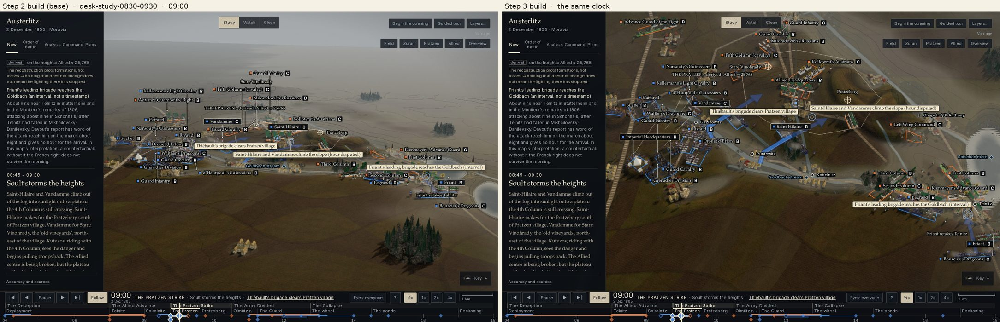
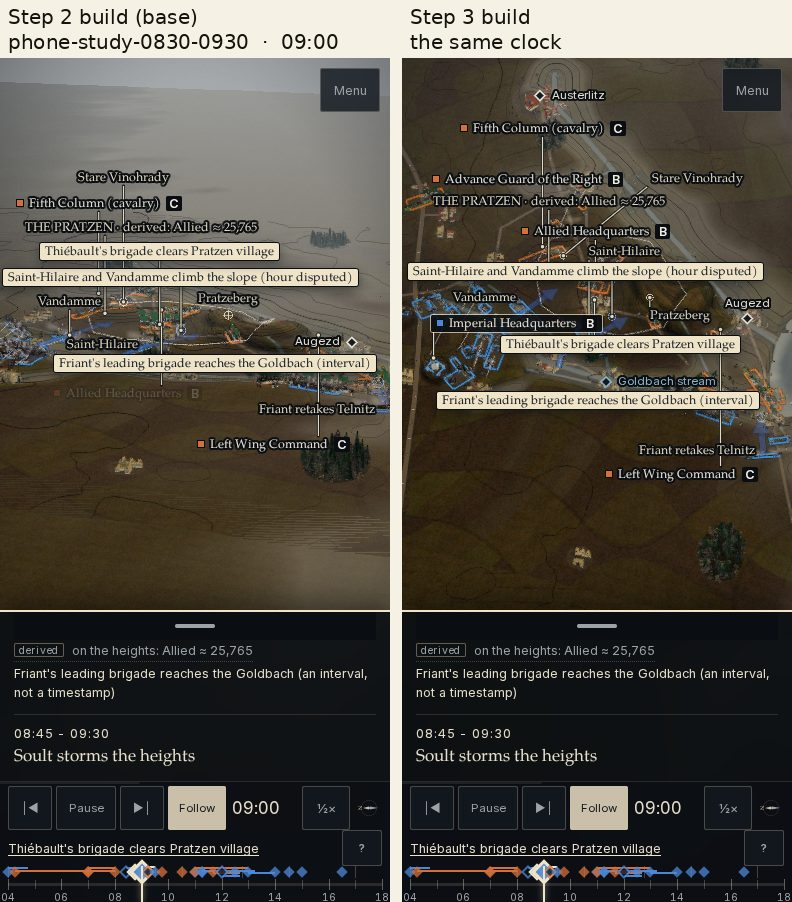

# UI/UX roadmap step 3: Follow framing and camera continuity (UA-02)

Evidence for the draft pull request. How each number was taken: [`METHOD.md`](METHOD.md). The runs' records: [`runs/`](runs/) (the full-day framing runs
on both builds, Step 2's measures again, the alternatives measured), [`continuity/`](continuity/), [`motion/`](motion/), [`rotate/`](rotate/), the matched
captures [`captures/`](captures/), and the hardware protocol with both builds [`device/`](device/).

## 0. The builds and the environment

| | Base (UI/UX step 2, `main` at `9d6b37451419721c759cca473da20bf8384f9247`) | This build |
|---|---|---|
| `austerlitz-command-map.html` | 3,071,014 bytes, md5 `07cbcaf32808c430198d55b1b7ed78b7` | **3,085,998 bytes, md5 `fd7b8b72c6315d1bb5bf0b8fa45cf263`** |
| SHA-256 | `06842ca46dfbdaf6c892de2393b83b5e28c6fe211a180c53244688bfbedaf186` | `48f5d6314e2b8b336d17d3be6caad94c5c4254471da6095605fd013d644c9b34` |

`origin/main` was `9d6b374` when the branch was made: the Step 2 merge itself (verified with `git merge-base --is-ancestor`).

**Every number here:** Chromium 141.0.7390.37 (Playwright 1.56.0's pinned build), headless, **software WebGL** (ANGLE on SwiftShader), Linux, 4 cores.
The phone is **Chromium's emulation** (390 x 844, density 3, touch, an iPhone's user agent), not a physical device. **Nothing here is a frame rate**;
the frame times are the owner's two devices' to give (section 6): both are filed (16 November 2026, after #113's merge); the phone's leave half-speed Play unsettled (section 6), accepted as measured on the owner's decision (a) of 17 November 2026 (section 10).

**The owner's decision** (15 November 2026, this step's brief): decision 78 is revisited for this step. During Landscape Play, Follow may use a
steeper, closer view fitted to the action. Pause, the natural end of Play and ordinary timeline seeks keep the camera pose instead of sending it to an
authored phase view. Explicit Phase and Act navigation still use their authored views; a vantage, a tour stop and an explicit centre-on-map command
stay as they were.

**The owner's decisions on the draft** (16 November 2026, "With decisions, let's go with your recommendations for all"): every point of section 10
as recommended, so the build is unchanged: `land-play`'s baseline moved; the phone's 360-600 units; Watch nearer than Study in proportion to its free
map; the ground's 150 px/s cap; the Follow button, PageUp and PageDown and Play at the day's end as built.

## 1. The result against the five acceptance points

| # | Target | Result | Met? |
|---|---|---|---|
| 1 | Frame the action: every live event above 0.3 inside the free map in at least 90% of its minutes; the share of live minutes with every one inside; the formations' box at 50% of the free map (desktop) and 40% (phone), with the formations in frame | Over the full battle at half speed (04:00 to 18:00, 683 live minutes, 1,500 event-minutes): **1440 x 900 Study** event-minutes inside 97.8% to **98.9%**, live minutes all inside 95.2% to **97.7%**, the box's median share **30.0% to 53.0%** (at 50% or more in 3.6% to 57.5% of frames), formations in the free map 28 to 23 (median, of 31). **Watch** 99.3% to 98.7%, 98.4% to 97.2%, box 22.1% to 52.6%. **390 x 844 Study** 93.0% to **99.1%**, 87.4% to **98.1%**, box **21.9% to 52.7%** (at 40% or more in 19.4% to 63.8% of frames), formations 18 to 16; phone Watch 93.1% to 100%. Every event at 90% or more but one, **Raigern (04:00-04:45) at 76% to 79%** (Step 2: 65%, 84%, 98%): the first minutes of a Play begun at 04:00 from phase 0's view, the eye held to 150 px/s on the screen while it comes | **Yes** but Raigern at the run's start (section 4) |
| 2 | Continuity by real input: Pause, resume, the end of Play, seeks inside and across phases, event markers and the chooser, Phase and Act buttons, manual camera with Follow off; the 150 px/s pan cap and the floor; the projected movement of angle and distance changes; reduced motion | The live block `ux3` (real clicks, drags, keys and taps): **every check passes on this build; on the Step 2 build 10 fail**: every cross-phase seek (the rail dragged, an event marker, the ten-minute button, the arrow key, the rail's PageDown, a day-track anchor, the Landscape with counters, under reduced motion, the phone's chooser) glided the eye 47 to 296 units to the phase's authored view, the ground crossing the screen at up to 1,807 px/s; and Play from a phase's view moved the ground at 494 px/s. Now no seek moves the eye (0.0000 units), the Phase and Act buttons still reach their authored views exactly, the target never passes 150 px/s and **the ground under the free map never passes 150 px/s** (149.9 at the most) (a new cap on the screen's movement of angle and distance changes: Step 2's ground moved at up to 586 px/s in Study, 746 px/s in Watch) | **Yes** (section 5) |
| 3 | Step 2's open targets: filled plates over the box against 12%, Watch's count against 12, eligible formation names drawn and why others were outside | 1440 x 900 Study, 08:30 to 09:30: filled plates **13.6% to 7.0% at most, over 12% in 28 to 0 of 548 frames**; 11:30 to 13:00 **17.9% to 11.6%, 91 to 0 of 728**. Watch: 13.4% to 5.3% and 13.8% to 7.5%, **0 frames over 12%**; Watch's labels at most 9 to 10 in the morning, **16 to 17 in the Guard action** (frames over 12: 504 to 344). Formations a live event names drawn: 100% of those in view on both builds; **"no name at that distance" 262 to 0** in the morning, 432 to 0 at noon. Phone: 35.7% to 26.4% at most, median 16.2% to 18.1%: still over 12% in most frames | Desktop **yes**; Watch's 12 **not** in the Guard action; the phone's 12% **no** (section 7) |
| 4 | Two-build hardware runs prepared, hashes and segments verified, census against Stage 7 and the budgets | Both builds in the repository, the protocol in `device/PROTOCOL.md`, the route run here on both at the desktop's and the phone's page sizes (each report naming its build's hash, `route-check.js` passing; section 6). Census here (every 60th frame of the full day drawn, `renderer.info`): desktop Study at most 854 calls and 2,157,913 triangles (Step 2: 854, 2,207,007), Watch 820 and **2,310,143** (854, 2,207,007: 28 blocks rich at that frame); the phone 551 calls (526) and 1,307,287 triangles (1,398,103). Within section 8.3's budgets (900 calls and 2.8 million on the desktop; 1.62 million and calls within 10% on the phone). **The owner's desktop** (16 November 2026, RTX 4070 at 144 Hz, four runs alternating the builds; `device/README.md`): section 8.3's budget, section 8.5's rule and the CPU line hold, Step 3's heaviest frame 829 calls and 2,300,331 triangles (Step 2's 843 and 2,317,629), every median at the refresh on both builds. **The owner's iPhone** (the same day, four runs): section 8.3's phone budget holds (Step 3's heaviest frame 1,311,877 triangles, its call medians at most +6.0%); section 8.5's rule fails in three segments of Step 3's runs, two of them drawing the same frames on both builds, the third half-speed Play (0% and 11.7% long on Step 3, 1.1% and 1.1% on Step 2): two runs a build cannot tell it from the phone's own spread | Desktop **verified**; the phone within its budget, half-speed Play **unsettled**, accepted as measured (the owner's decision (a), 17 November 2026; section 10) |
| 5 | The checks; a regression test of the cross-phase issue; guarded declarations byte-identical; the build rebuilt, fingerprinted, logged | `npm test`, `check:data` (143 of 143 identical), `check:chronology`, `check:contrast` and `check:selftest` (354 checks) pass here and on CI; the full `check:visual` dispatched on CI (section 8). The regression test is the live block `ux3` (10 failures on Step 2, none here), with `css-test.js`'s rule and `runtime-test.js`'s dry run in `npm test`. One motion baseline moved, on the owner's word (16 November 2026) | **Yes**; `check:visual` passed on CI (run 43801145325, section 8) |

## 2. The framing chosen

**Follow during Landscape Play** (`app.js` `FOLLOW`, `followGoal`, `followStep`, `followFlow`):

| | Desktop and held landscape (`FOLLOW`) | A phone held upright (`FOLLOW.P`) |
|---|---|---|
| Elevation | **52 degrees** (the phase's authored azimuth kept; Step 2 took the authored direction, 15 to 36 degrees up) | **55 degrees** |
| Distance | fitted: the least that puts every live event's place inside the free map with 12% of its half-size to spare, within **200 to 400 units** for Study's free map at 1440 x 900; a larger free map (Watch) brings both nearer in proportion (about 159 to 318 at 1440 x 900), a smaller one (a short window, a phone held landscape) takes the far limit farther (up to about 700) and keeps the near one. Step 2: 2.4 x the events' radius + 130, in 230 to 300 | fitted the same way, **360 to 600 units** for Study's free map at 390 x 844 (Step 2: 230 to 300 x 1.75, about 403 to 525) |
| Which events | each live event's place drawn toward the events' weighted centre by its weight's share (smoothstep from 0.05 to 0.35), **and the events 16 clock minutes ahead**, so an event about to begin is framed before its weight reaches 0.3 | the same |
| Motion | eased in real time (1.5 s), the azimuth and the elevation apart (a turn keeps the elevation); the target held to **150 px/s on the screen**, now measured as the screen shows it (a change of distance or direction that moves it counts too); **the drawn ground under a 5 x 5 grid of the free map held to 150 px/s** (`FOLLOW.FLOW`, new); both caps found again on the pose that will be drawn until it is within them; never through the floor | the same |
| No live event | the target and the distance held; the direction eased to 52 degrees at the phase's azimuth | the same |
| Reduced motion | at each event's start, at once (not when Play is pressed), as before | the same |

**When the clock stops or moves by other means** (`setClock`'s note in `app.js`): a pause, the natural end of Play, the rail dragged or pressed, its keys
(PageUp and PageDown among them: the slider's own steps), an event marker and the chooser, the ten-minute buttons and the window's arrow keys, a
day-track anchor, an event dossier's "Go to this moment" (whose centring is its own deliberate move) and Play pressed at the day's end **keep the eye
where it is**. The phase's authored view is asked for only by the Phase buttons, the Act buttons, the phone's phase list (`setPhase`), the start and the
self-test. The Follow button, pressed while the clock plays, now takes the view up from where it is; pressed with the clock stopped it still glides to
the phase's view (setFollow). The paper map: nothing follows, as before.

## 3. The alternatives measured (desktop Study at 1440 x 900 and the phone at 390 x 844, the full day)

Each line one full-day run (`runs/alternatives/`, the summaries; the build each ran on is named in it: intermediate builds of this branch, the rows marked "chosen" re-run on this build, `runs/framing/`). In the order they were tried:

| Run | Elevation, distances | Event-minutes inside | Live minutes all inside | Events under 90% | Box median (at goal) | Ground's move max (px/s) | Rich blocks median, max |
|---|---|---|---|---|---|---|---|
| Step 2 | authored, 230-300 | 97.8% | 95.2% | Raigern 65%, Telnitz 79% | 30.0% (3.6%) | 586 | 1, 5 |
| first candidate | 52, 200-320 | 90.7% | 86.2% | five, Raigern 0% | 52.8% (57.4%) | 385 | 2, 9 |
| `d1` | 52, 200-400 | 97.1% | 93.6% | Raigern, Telnitz 64%, Sokolnitz 75%, Davout 83% | 52.8% (57.4%) | 475 | 2, 9 |
| `d3` | 55, 200-400 | 96.9% | 93.1% | four | 53.9% (59.4%) | 499 | 2, 8 |
| `d4` | 50, 200-400, margin 0.10 | 97.2% | 93.9% | four | 53.1% (56.5%) | 446 | 2, 9 |
| `d5` | 52, 180-400 | 96.5% | 92.2% | five | 52.1% (52.3%) | 523 | 9, 18 |
| `d6` | 52, 220-400 | 97.5% | 94.4% | four | 50.0% (50.1%) | 433 | 0, 1 |
| `e1`-`e3` | 52, 200-400, events 8, 12, 16 min ahead | 98.4%, 98.7%, 98.9% | 96.5%, 97.1%, 97.7% | Raigern (and Telnitz at 8, 12) | 53.0% | 353 | 2, 6 |
| `e4` | the same at 12, easing 1.0 s | 99.1% | 97.8% | Raigern | 52.9% | 531 | 2, 6 |
| `f2`, `f3`, `h1` | 16 ahead, the ground capped at 300, 200, 150 px/s | 98.9% each | 97.7%, 97.7%, 97.5% | Raigern | 52.9-53.0% | 254, 192, 154 | 2, 6 |
| **chosen** (this build) | **52, 200-400, 16 ahead, both caps 150** | **98.9%** | **97.7%** | Raigern 76% | **53.0% (57.5%)** | **156** (150 under the free map) | **2, 6** |
| Watch at 200 (`h2`) | as chosen, no scaling | 99.0% | 97.8% | Raigern | 45.2% (38.1%) | 156 | 2, 7 |
| Watch at 175 (`w2`), at 160 (`w1`) | | 99.0%, 98.6% | 97.8%, 96.9% | Raigern; and Telnitz 79% at 160 | 48.9%, 52.7% | 156, 159 | 11, 23; 18, 30 |
| **Watch chosen** (scaled to its free map, 159-318) | | **98.7%** | **97.2%** | Raigern, Telnitz 86% | **52.6% (54.8%)** | 150 | 18, 30 |
| 844 x 390, distances unscaled (`l1`) | 52, 200-400 | 91.3% | 88.7% | Raigern 0%, counter-march 75%, Telnitz 86% | 39.1% | 126 | 0, 0 |
| 844 x 390, both scaled (`k5`) | 52, 351-704 | 98.9% | 97.7% | Raigern | 26.3% | 144 | 0, 0 |
| **844 x 390 chosen** (only the far limit scaled) | 52, 200-704 | **98.8%** | **97.4%** | Raigern, Telnitz 89% | **39.0%** | 150 | 0, 0 |
| phone `p3`, 260-600 | 55 | 93.5% | 87.8% | eight | 40.9% (51.9%) | 387 | 0, 0 |
| phone `p1`, 300-600 | 55 | 95.1% | 90.5% | five | 52.9% (57.2%) | 289 | 0, 0 |
| phone `p2`, 300-600 | 60 | 94.9% | 90.0% | six | 55.5% (57.5%) | 295 | 0, 0 |
| phone `p6`, 360-600 | 55 | 96.8% | 93.3% | five | 52.0% (60.1%) | 289 | 0, 0 |
| phone `p4`, 300-600, looking north | 55, north up | 89.3% | 83.3% | Raigern 2%, five more | 64.4% (81.8%) | 303 | 0, 0 |
| phone 300 / 330 / 360, 12 ahead (`q2`, `q3`, `q1`) | 55 | 97.7%, 98.7%, 99.0% | 95.9%, 97.1%, 97.8% | Raigern | 53.7%, 55.0%, 53.0% | 300 | 0, 0 |
| **phone chosen**, 360-600, 16 ahead, caps | 55 | **99.1%** | **98.1%** | Raigern 79% | **52.7% (63.8%)** | 151 without the view offset's frames | 0, 0 |

**What decided it.** 50 to 55 degrees made little difference (`d1`, `d3`, `d4`); the far limit had to be 400, not 320, for the dawn's two events
1.5 km apart (Raigern and the counter-march); the near limit 200 kept the box above 50% (180 brought nine blocks onto the rich kit and lost events;
220 held the box at 50.0%); what lifted the events above 90% was **framing the events about to begin** (Telnitz, Sokolnitz and Davout each begin while
the eye is still panning toward them under the 150 px/s cap: 16 clock minutes ahead is 3.2 s at half speed). Capping the ground at 150 px/s cost no
event-minute (`h1` against `e3`). **The phone:** at 300 units, as the audit tried, 2.3% more event-minutes fall out than at 360 (97.7% against 99.1%)
for no gain in the box or in names (at 300 to 360 units a division's name, collected within 300, is not collected either way: 5 names in the layer, 2
drawn); a north-up view gives the box 64% but loses Raigern at dawn entirely, and turns the field 90 degrees against every other view of it, so it was
not taken. **Watch** has no rail, so its free map is 27% larger; at Study's 200 units its box stood at 45%; taking the distances in proportion to the
free map brings it to 52.6% and 18 blocks onto the rich kit (median; 30 at most).

## 4. Matched before and after: the full battle at half speed

`runs/framing/` (each build's summary and log); one start (04:00, phase 0's authored view), the same frames.

Each pair: the Step 2 build, then this build (`step2-`, `step3-`); every run 6,240 frames.

| run | event-minutes inside | live minutes, all inside | events under 90% | box median | box at goal | formations in the free map (median, min) | eye: units, degrees | ground's move: max, p95 (px/s) | target max (px/s) | rich blocks: median, max | names in the layer / drawn (median) | filled plates over the box: median, max |
|---|---|---|---|---|---|---|---|---|---|---|---|---|
| step2-desk-study | 1467 of 1500 (97.8%) | 650 of 683 (95.2%) | raigern 65%, telnitz 79% | 30.0% | 3.6% (goal 50%) | 28, 13 (of 31) | 230, 24.92 | 586.4, 181.9 | 144.1 | 1, 5 | 26 / 23 | 6.1%, 19.2% |
| step3-desk-study | 1484 of 1500 (98.9%) | 667 of 683 (97.7%) | raigern 76% | 53.0% | 57.5% (goal 50%) | 23, 13 (of 31) | 199.99, 52 | 155.7, 149.7 | 129.3 | 2, 6 | 29 / 21 | 4.2%, 11.7% |
| step2-desk-watch | 1489 of 1500 (99.3%) | 672 of 683 (98.4%) | raigern 84% | 22.1% | 0.0% (goal 50%) | 30, 16 (of 31) | 230, 24.92 | 745.6, 223.9 | 144.1 | 1, 6 | 26 / 3 | 4.6%, 14.3% |
| step3-desk-watch | 1481 of 1500 (98.7%) | 664 of 683 (97.2%) | raigern 76%, telnitz 86% | 52.6% | 54.8% (goal 50%) | 23, 13 (of 31) | 158.75, 52 | 149.9, 149.8 | 129.8 | 18, 30 | 31 / 4 | 2.9%, 8.6% |
| step2-phone-study | 1395 of 1500 (93.0%) | 597 of 683 (87.4%) | decision 54%, davout 52%, buxhowden-blind 51%, davout-resumes 64% | 21.9% | 19.4% (goal 40%) | 18, 12 (of 31) | 402.89, 24.92 | 485.7, 105.1 (335.7 without the 186 frames the view offset moved) | 289 (84.6) | 0, 0 | 5 / 3 | 14.8%, 49.1% |
| step3-phone-study | 1487 of 1500 (99.1%) | 670 of 683 (98.1%) | raigern 79% | 52.7% | 63.8% (goal 40%) | 16, 10 (of 31) | 359.96, 55 | 298.2, 88.5 (150.8 without the 186 frames the view offset moved) | 296.8 (110.1) | 0, 0 | 5 / 2 | 11.0%, 38.8% |
| step2-phone-watch | 1396 of 1500 (93.1%) | 598 of 683 (87.6%) | decision 54%, davout 52%, buxhowden-blind 51%, davout-resumes 64% | 15.1% | 2.0% (goal 40%) | 18, 12 (of 31) | 402.89, 24.92 | 556.7, 118.6 | 84.6 | 0, 0 | 5 / 1 | 14.6%, 49.1% |
| step3-phone-watch | 1500 of 1500 (100.0%) | 683 of 683 (100.0%) | none | 43.4% | 58.9% (goal 40%) | 16, 11 (of 31) | 359.95, 55 | 149.9, 104.1 | 117.8 | 0, 0 | 5 / 1 | 9.2%, 38.4% |
| step2-844x390 | 1392 of 1500 (92.8%) | 575 of 683 (84.2%) | raigern 0%, telnitz 0%, sokolnitz 64%, davout 88% | 32.1% | 0.5% (goal 50%) | 28, 13 (of 31) | 230, 24.92 | 214.2, 84.7 | 83.9 | 0, 0 | 26 / 17 | 19.4%, 48.3% |
| step3-844x390 | 1482 of 1500 (98.8%) | 665 of 683 (97.4%) | raigern 76%, telnitz 89% | 39.0% | 16.0% (goal 50%) | 20, 7 (of 31) | 200.38, 52 | 149.9, 109 | 62.2 | 0, 0 | 29 / 15 | 20.3%, 50.4% |
| step2-1280x720 | 1458 of 1500 (97.2%) | 641 of 683 (93.9%) | raigern 56%, telnitz 64% | 31.5% | 1.4% (goal 50%) | 28, 14 (of 31) | 230, 24.92 | 437.9, 143.8 | 115.3 | 0, 2 | 26 / 22 | 9.0%, 21.9% |
| step3-1280x720 | 1483 of 1500 (98.9%) | 666 of 683 (97.5%) | raigern 76% | 52.5% | 52.0% (goal 50%) | 22, 13 (of 31) | 200, 52 | 157.3, 149 | 115.7 | 0, 0 | 29 / 20 | 6.6%, 18.0% |
| step2-1280x720-watch | 1489 of 1500 (99.3%) | 672 of 683 (98.4%) | raigern 84% | 21.7% | 0.0% (goal 50%) | 30, 18 (of 31) | 230, 24.92 | 622, 185.2 | 115.3 | 0, 2 | 26 / 3 | 6.4%, 20.3% |
| step3-1280x720-watch | 1483 of 1500 (98.9%) | 666 of 683 (97.5%) | raigern 76% | 50.9% | 51.3% (goal 50%) | 25, 13 (of 31) | 164.26, 52 | 149.9, 149.7 | 125.1 | 1, 9 | 29 / 3 | 4.4%, 13.2% |
| step2-1024x768 | 1300 of 1500 (86.7%) | 515 of 683 (75.4%) | raigern 68%, telnitz 79%, decision 48%, davout 24%, buxhowden-blind 17%, davout-resumes 0% | 27.2% | 15.8% (goal 50%) | 16, 12 (of 31) | 230, 24.92 | 462.4, 141 | 123 | 0, 2 | 26 / 13 | 12.6%, 51.2% |
| step3-1024x768 | 1481 of 1500 (98.7%) | 664 of 683 (97.2%) | raigern 76% | 54.2% | 55.9% (goal 50%) | 13, 8 (of 31) | 199.1, 52 | 149.9, 131.9 | 120.4 | 0, 0 | 29 / 11 | 8.6%, 33.8% |
| step2-hybrid | 1467 of 1500 (97.8%) | 650 of 683 (95.2%) | raigern 65%, telnitz 79% | 30.0% | 3.6% (goal 50%) | 28, 13 (of 31) | 230, 24.92 | 586.4, 181.9 | 144.1 | 0, 2 | 0 / 0 | 18.2%, 33.1% |
| step3-hybrid | 1484 of 1500 (98.9%) | 667 of 683 (97.7%) | raigern 76% | 53.0% | 57.5% (goal 50%) | 23, 13 (of 31) | 199.99, 52 | 155.7, 149.7 | 129.3 | 0, 0 | 0 / 0 | 16.2%, 31.7% |

The ground's move here counts every point on the screen (the free map's grid and the qualifying events' places wherever they stand); the cap holds the ground under the free map, which never passed 149.9 px/s. "Filled plates over the box" is Step 2's coverage measure over the whole day (its acceptance windows are in section 7).

**Per event** (minutes inside of minutes it qualifies; misses by cause: off the screen, under a panel, in the margin). The events at 100% on every run below are left out (19 of 25):

| event | step2-desk-study | step3-desk-study | step2-desk-watch | step3-desk-watch | step2-phone-study | step3-phone-study |
|---|---|---|---|---|---|---|
| raigern | 41 of 63 (65%); out: offscreen 7, panel 3, margin 12 | 48 of 63 (76%); out: offscreen 7, panel 4, margin 4 | 53 of 63 (84%); out: offscreen 6, panel 3, margin 1 | 48 of 63 (76%); out: offscreen 11, panel 4 | 62 of 63 (98%); out: margin 1 | 50 of 63 (79%); out: panel 8, margin 5 |
| telnitz | 22 of 28 (79%); out: panel 1, margin 5 | 27 of 28 (96%); out: margin 1 | 28 of 28 (100%) | 24 of 28 (86%); out: panel 3, margin 1 | 28 of 28 (100%) | 28 of 28 (100%) |
| decision | 48 of 48 (100%) | 48 of 48 (100%) | 48 of 48 (100%) | 48 of 48 (100%) | 26 of 48 (54%); out: offscreen 16, margin 6 | 48 of 48 (100%) |
| davout | 53 of 58 (91%); out: offscreen 5 | 58 of 58 (100%) | 57 of 58 (98%); out: offscreen 1 | 58 of 58 (100%) | 30 of 58 (52%); out: offscreen 11, margin 17 | 58 of 58 (100%) |
| soult | 58 of 58 (100%) | 58 of 58 (100%) | 58 of 58 (100%) | 58 of 58 (100%) | 57 of 58 (98%); out: margin 1 | 58 of 58 (100%) |
| buxhowden-blind | 88 of 88 (100%) | 88 of 88 (100%) | 88 of 88 (100%) | 88 of 88 (100%) | 45 of 88 (51%); out: offscreen 10, margin 33 | 88 of 88 (100%) |
| davout-resumes | 28 of 28 (100%) | 28 of 28 (100%) | 28 of 28 (100%) | 28 of 28 (100%) | 18 of 28 (64%); out: offscreen 5, margin 5 | 28 of 28 (100%) |

Raigern (04:00-04:45, 1.5 km west of the counter-march) is the first event of a Play begun at 04:00 from phase 0's authored view: the eye reaches it within the caps in its first 10 to 20 clock minutes, so it is outside in those minutes on every desktop run (on the Step 2 build too). Everything the phone missed on the Step 2 build (the decision 54%, Davout 52%, Buxhowden's blindness 51%, Davout resuming 64%) is now inside in every minute.

**Several events at once, and none** (`tools/ux-step3/compete.js`, the full day in Study, frames by the number of events above 0.3):

| events above 0.3 | frames | Step 2: eye, box, all inside | Step 3: eye, box, all inside |
|---|---|---|---|
| none | 940 | 230 units, 23.3%, - | 200 units, 31.6%, - |
| 1 | 1,951 | 230 (230-319), 28.7%, 98.4% | 200 (200-385), 43.8%, 98.4% |
| 2 | 1,206 | 230 (230-300), 31.0%, 91.0% | 200 (200-387), 31.6%, 93.3% |
| 3 | 1,026 | 230 (230-258), 34.8%, 93.5% | 200, 62.3%, 99.4% |
| 4 | 840 | 230 (230-256), 29.6%, 100% | 200, 67.9%, 100% |
| 5 or more | 276 | 235 (230-240), 28.5%, 100% | 200, 63.3%, 100% |

Several events usually lie close enough that the fit stays at 200 units; it goes farther (up to 387) for the dawn's and morning's pairs far apart. At the 39 handoffs (a frame where the set of events above 0.3 changes) the ground moved at up to 316 px/s on the Step 2 build in the two seconds after one (its largest, 586, elsewhere: a phase's new azimuth at 12:45); now at up to 156 (any point on the screen) and 150 under the free map. **Minutes with no live event** (940 frames, 162 minutes: 10:03-10:05 and 16:48 on): the target and the distance hold; only the direction eases (to 52 degrees at the phase's azimuth), so the view turns slowly at a phase boundary and otherwise stands still.

**The rich kit and the names** (the closer camera's costs): in Study the blocks drawn rich rise from 1 to 2 at the median (5 to 6 at most), the
formation names in the layer from 26 to 29 (median), the names drawn from 23 to 21; in Watch rich blocks 1 to 18 (6 to 30 at most). On the phone
neither moves (0 rich blocks; 5 names in the layer): at 360 units and beyond the phone collects what it collected at 403.

**Reduced motion** (Play from 08:20 to 10:00, the preference emulated; `runs/framing/*-rm`): on both builds the eye moved in exactly 6 of 960 frames, each in the frame whose clock reached an event's start (08:25, 08:45, 09:00, 09:15, 09:30, 09:45), at once, and stood still in every other. With step 3's goal at those jumps: event-minutes inside 94.4% to **98.1%** on the desktop and 72.9% to **98.1%** on the phone; the box 25.5% to 55.4% and 16.3% to 56.2%. The block `ux3` holds the same by real input, and a cross-phase drag under reduced motion keeps the eye.

## 5. Camera continuity by real input (`continuity/`)

The block `ux3` (`tools/visual/ux3.js`), alone by `tools/ux-step3/continuity.js`, on each build (`continuity/step2.log`, `continuity/step3.log`):

| Case (real input) | Step 2 | Step 3 |
|---|---|---|
| Play from 08:30 (phase 2's view) by a click: the target / the ground's largest move | 135 / **494 px/s** | 70 / 150 px/s |
| A pause by a click: the eye then, and 120 frames on | held, held | held, held |
| Play again from the held view | target 18, ground 57 px/s | target 65, ground 76 px/s |
| The natural end of Play (from 17:55) | held | held |
| The rail dragged inside phase 4 (09:35 to 10:20) | eye kept | eye kept |
| **The rail dragged from 10:00 into 10:50 (phase 4 to 5)** | **eye moved 197.9 units to phase 5's view (ground at 1,807 px/s)** | kept (0) |
| **The Kursk marker (10:30) clicked from 10:00** | **moved 197.9**, the event selected | kept, the event selected, the clock at 10:30 |
| **The ten-minute button from 10:25** | **moved 197.9** | kept |
| **The window's arrow key from 10:25** | **moved 197.9** | kept |
| **The rail's PageDown from 10:00** | **moved 197.9** | kept |
| **A day-track anchor (Saint-Hilaire, 11:15) from 10:00** | **moved 47.1** | kept |
| A Phase button (phase 7) | at its authored view (0.0000) | at its authored view (0.0000) |
| An Act button by Enter (its first phase) | at its authored view | at its authored view |
| The Pratzen vantage | at its view | at its view |
| An event's "Go to this moment" | the event centred, Follow off | the event centred, Follow off |
| Follow off by a drag, then a cross-phase drag and Play | eye kept | eye kept |
| **The Landscape with counters, a cross-phase drag** | **moved 197.9** | kept |
| The paper map, a cross-phase drag and Play | its plan kept | its plan kept |
| Reduced motion: Play, then a pause | moved once, at an event's start; held | the same |
| **Reduced motion: a cross-phase drag** | **moved 197.9** | kept |
| **A phone: the 11:00 set's chooser by taps, from 10:00** | **moved 296.5** | kept, the event selected |
| Judged (`thresholds.js` `checkUx3`) | **10 failures** | **every check passes** |

**The projected movement during angle and distance changes.** Step 2 capped only the target's move over the ground. While the eye tilted and
zoomed (a handoff between events, a phase's new azimuth, Play from an authored view) the ground under the free map crossed the screen at up to 586
px/s in Study (746 in Watch, 557 on the phone); its 95th percentile was 182 to 224 px/s. This build holds that ground to 150 px/s
(`FOLLOW.FLOW`), so a phase's new azimuth (77 degrees at 17:00, phases 8 to 9) turns the view more slowly than before (its duration not measured). Measured by the
framing probe over every point on the screen (the free map's grid and the qualifying events' places, wherever they stand on the screen): the largest 586 to 156 px/s in Study, 746 to 150 in Watch, 557 to 150 in the phone's Watch; the 95th percentile 182 to 150 and 224 to 150. Under the free map the cap holds 149.9 px/s at most (the self-test reads the same at 1x, 4x and 10.33x with 100 ms steps).
On the phone the view offset itself eases when the dispatch sheet changes height (the phase's text changing length): every point then moves at up to
297 px/s (289 on the Step 2 build), whatever Follow does; those frames are counted apart. **The floor:** the eye never went below it in any run
(its least clearance 55 units on Step 2, 118 or more now).

## 6. The hardware runs (both devices received)

**The owner's desktop, 16 November 2026** (`device/README.md`, the reports `device/desk-S{2,3}-{1,2}.{txt,json}` verbatim, read by
`tools/ux-step3/device-runs.js` into `device/reading.txt`): the RTX 4070 desktop of Stage 7's runs, Chrome 157, 2,560 x 1,440 at 144 Hz; the ordinary
route four times, Step 2, Step 3, Step 2, Step 3. Each report its route's own `format()`, its build the pinned copy its name says, the route whole,
`route-check.js` passing.

| | Step 2 (two runs) | Step 3 (two runs) | rule |
|---|---|---|---|
| heaviest frame (any segment) | 843 calls, 2,317,629 triangles (play-4x) | **829 calls, 2,300,331 triangles** (play-4x) | section 8.3: at most 900 and 2.8 million: **within** |
| median interval, every segment | 6.9 ms | 6.9 ms | section 8.5: no move over one refresh: **holds** |
| long-frame share, every segment | 0% | 0% | section 8.5: none rising above 5%: **holds** |
| `js50`, the largest excess over Step 2 | | +0.1 ms (overview, orbit, effects off) | CPU line: at most +1 ms: **holds** |
| play-4x (Follow, 08:30 at 4x, 12 s): fps, missed refreshes | 143.8/143.9, 0.1%/0.1% | 143.9/143.8, 0.1%/0.1% | |
| play-4x: calls median (max), triangles max, `js50`, GPU median | 823 (843), 2,317,629, 4.3/4.3, 2.8/2.7 ms | 794 (829), 2,300,331, 4.3/4.3, 2.8/3.0 ms | |
| play-half (Follow, 08:30 at ½×, 12 s): fps, missed refreshes | 143.9/144, 0.1%/0% | 143.9/144, 0.1%/0% | |
| play-half: calls median (max), triangles max, `js50`, GPU median | 789 (827), 2,273,009, 5.0/5.0, 3.9/3.9 ms | 781 (817), 2,289,379, 4.9/4.9, 4.0/4.0 ms | |

Every other segment sets its own camera and draws identical frames on both builds (calls, triangles and their maxima the same run for run). Step 2's
played segments draw what Stage 7's `desk-S7-*` drew (823/843 calls, 2,317,629 and 2,317,741 triangles at most; 789/827, 2,273,009), so the only change
in what they draw since Stage 7 is this step's, and at 144 Hz it shows in no frame time. The GPU timer's medians differ between the builds by at most 0.3 ms in the played
segments, inside that timer's spread between one build's own two runs in the held views (up to 3.3 ms). Not shown by this desktop: a slower GPU's
answer to half speed's +0.7% triangles.

**The owner's iPhone 17 Pro, the same day** (23:23 to 23:34 UTC; `device/phone-S{2,3}-{1,2}.{txt,json}`, `device/README.md`): Safari 26.6.1, 402 x 714
drawn at density 1 (`lowTier`), refresh 17 ms; Step 2, Step 3, Step 2, Step 3, 29-34 s apart. Each report verbatim, its build the pinned copy its
label names, the route whole, `route-check.js` passing.

| | Step 2 (two runs) | Step 3 (two runs) | rule |
|---|---|---|---|
| heaviest frame | 1,394,981 triangles (play-half) | **1,311,877 triangles** (overview orbit) | section 8.3: at most 1.62 million: **within** |
| segment medians of calls | | at most +6.0% over Step 2's (play-half 481 to 510) | section 8.3: at most +10%: **within** |
| play-4x: fps, long-frame share, calls median (max) | 60/60, 0%/0%, 430 (525) | 60/59.7, 0%/0.3%, 425 (539) | |
| play-half: fps, long-frame share, calls median (max), triangles max | 53.4/53.7, 1.1%/1.1%, 481 (528), 1,394,981 | **60/50.8, 0%/11.7%**, 510 (550), 1,308,005 | section 8.5: **fails** in Step 3's second run |
| ph8 overview, orbit / orbit with effects off (the same frames on both builds) | 60 fps, 0% / 58.8-60 fps, 0-0.3% | 50.9-45 fps, 0-23.7% / 39-37.1 fps, 42.9-76% | section 8.5: **fails**; Stage 7's runs of the same frames 47-48 fps, 8.9-15.6% / 30-34 fps, 80-89% |

Step 2's half-speed Play slows at the same moment in every run on this phone, today's and Stage 7's (the same frames, 481 calls): 6.4-6.7 s into the
12 s (about 08:50 on the clock), to 47.3-48.5 frames a second. Step 3's two runs draw identical frames to each other (510 calls) and one never slows
(60 frames a second, 0% long: better than any Step 2 or Stage 7 run) while the other slows from 6.3 s to 44.5 frames a second (23.1% long in its second
half: worse than any). That second Step 3 run was the session's slowest in the segments both builds draw alike (5 of them under 59 frames a second,
against 2, 3 and 1 in the other runs). So the phone's own state moved more between runs than the builds differ, and two runs a build cannot say
whether Step 3's closer view costs the phone in half-speed Play; what the build certainly changes there is 6.0% more draw calls and 6.2% fewer
triangles at most. Put to the owner in section 10, who accepted it as measured (decision (a), 17 November 2026).

### Before the devices

`device/PROTOCOL.md`: the two builds, each a pinned copy in `device/builds/` (Step 2's `austerlitz-07cbcaf3-step2.html`, and Step 3's
`austerlitz-fd7b8b72-step3.html`, byte for byte this build, so that both links keep working after `main` moves on), the owner's steps once #113 is
merged and Pages has published `main`, the links, the order (Step 2, Step 3, Step 2, Step 3, two minutes apart) on the RTX 4070 desktop and the iPhone 17 Pro, what is checked (`route-check.js`, the hashes, every segment of the
ordinary route) and against what (sections 8.3 and 8.5 of `docs/STAGE8_SPEC.md`, Step 3 against Step 2 of the same session; Stage 7's runs for the
record).

**Here** (`tools/step6/perf-local.js --way frame`, the owner's page and build switch; software WebGL, so frame times decide nothing; `device/local/`):
the pinned Step 3 copy loads through `perf-run.html` by its `?src=` path and its report names it by 3,085,998 bytes and `48f5d631...` (a trial run, its
frames too few here to read); both builds load through `perf-run.html` (Step 3 by default, Step 2 by `?src=`), each report names its build by bytes and SHA-256 (3,085,998 /
`48f5d631...` and 3,071,014 / `06842ca4...`), and `route-check.js` passes on all four reports. At the desktop's page size (2,560 x 1,305) software
rendering drew too few frames for most segments to record any (4 of 23 with frames on each build), so the route's run here proves the page, the
build switch and the report, not the segments' content; at the phone's (402 x 714, the low tier) 19 and 21 segments recorded frames. In the two
played segments on the phone (the first 13 to 15 frames of Play from 08:30 under Follow): calls 471 to 424 and triangles 1,269,269 to 1,142,527 at
half speed; 456 to 399 and 1,258,663 to 1,146,821 at 4x. **The census of Follow's own frames** is the framing probe's (every 60th frame of the full
day drawn and counted, section 1 point 4): desktop Study at most 854 calls and 2,157,913 triangles (Step 2: 854, 2,207,007), Watch 820 and
2,310,143 (854, 2,207,007), the phone 551 and 1,307,287 (526, 1,398,103); against Stage 7's device runs (`desk-S7-*`, 2,560 x 1,305: Play at half speed
827 calls and 2,273,009 triangles at most; `phone-S7-*`: 1,395,047 triangles at most) and within section 8.3's budgets (900 and 2.8 million; 1.62
million and calls within 10%: the phone's largest 551 is 4.8% above Step 2's 526). The closer view brings more blocks onto the rich kit in Watch
(18 at the median, 30 at most; Study 2 and 6) and leaves the phone's at 0.

## 7. Step 2's targets again

Step 2's tool and arguments (`METHOD.md`) on both builds; the Step 2 rows are that build's runs, and seven of them were run again here and reproduced its committed records in every number (`tools/ux-step2/probe.js` is deterministic). This build's records: `runs/step2-measures/`.

| run | build | filled plates over the box: max / median / frames over 12% | box's share of the free map (median) | labels drawn: max / median / frames over 12 | event-named formations drawn of in view | outside the measure: distance / off screen / panel / reading / corps | tier 3 vs casing: min / below 4.5 | label pass: median / 95th (ms) |
|---|---|---|---|---|---|---|---|---|
| desk-counters-0830-0930 | Step 2 | 28.4% / 23.4% / 539 of 548 | 29.6% | 32 / 25 / 548 | 2223 of 2969 (74.9%) | 0 / 0 / 0 / 0 / 221 | none drawn | 1.3 / 4.5 |
| desk-counters-0830-0930 | Step 3 | 17.0% / 14.0% / 410 of 548 | 72.8% | 39 / 28 / 548 | 1985 of 2852 (69.6%) | 0 / 0 / 0 / 0 / 182 | none drawn | 1.9 / 5.7 |
| desk-paper-0830-0930 | Step 2 | 43.5% / 36.5% / 548 of 548 | 9.9% | 25 / 22 / 548 | 595 of 665 (89.5%) | 2585 / 0 / 0 / 0 / 0 | none drawn | 0.8 / 1.8 |
| desk-paper-0830-0930 | Step 3 | 43.5% / 36.5% / 548 of 548 | 9.9% | 25 / 22 / 548 | 595 of 665 (89.5%) | 2585 / 0 / 0 / 0 / 0 | none drawn | 1.2 / 3 |
| desk-study-0830-0930 | Step 2 | 13.6% / 8.6% / 28 of 548 | 29.6% | 43 / 32 / 548 | 2706 of 2706 (100.0%) | 262 / 0 / 1 / 0 / 221 | 7.47 / 0 | 1.5 / 3.9 |
| desk-study-0830-0930 | Step 3 | 7.0% / 4.6% / 0 of 548 | 72.8% | 43 / 37 / 548 | 2851 of 2851 (100.0%) | 0 / 0 / 1 / 0 / 182 | 2.88 / 2 | 1.6 / 4.2 |
| desk-study-1130-1300 | Step 2 | 17.9% / 8.6% / 91 of 728 | 36.6% | 43 / 36 / 728 | 6878 of 6878 (100.0%) | 432 / 29 / 0 / 0 / 728 | 7.46 / 0 | 1.3 / 2.9 |
| desk-study-1130-1300 | Step 3 | 11.6% / 7.8% / 0 of 728 | 63.3% | 45 / 39 / 728 | 6837 of 6837 (100.0%) | 0 / 18 / 214 / 0 / 728 | 8.4 / 0 | 1.7 / 4.1 |
| desk-study-al-0830-0930 | Step 2 | 13.6% / 8.5% / 28 of 548 | 29.6% | 33 / 23 / 548 | 2380 of 2380 (100.0%) | 262 / 0 / 1 / 547 / 0 | 7.47 / 0 | 1.3 / 3.1 |
| desk-study-al-0830-0930 | Step 3 | 7.0% / 4.4% / 0 of 548 | 72.8% | 35 / 32 / 548 | 2603 of 2603 (100.0%) | 0 / 0 / 1 / 430 / 0 | 7.39 / 0 | 1.4 / 3.6 |
| desk-watch-0830-0930 | Step 2 | 13.4% / 8.7% / 28 of 548 | 19.0% | 9 / 7 / 0 | 2752 of 2752 (100.0%) | 262 / 0 / 0 / 0 / 236 | none drawn | 1 / 2.5 |
| desk-watch-0830-0930 | Step 3 | 5.3% / 3.1% / 0 of 548 | 67.7% | 10 / 7 / 0 | 2962 of 2962 (100.0%) | 0 / 0 / 52 / 0 / 236 | none drawn | 1.2 / 4.5 |
| desk-watch-1130-1300 | Step 2 | 13.8% / 8.3% / 41 of 728 | 23.9% | 16 / 13 / 504 | 6934 of 6934 (100.0%) | 432 / 18 / 0 / 0 / 728 | none drawn | 1.1 / 2.4 |
| desk-watch-1130-1300 | Step 3 | 7.5% / 6.0% / 0 of 728 | 62.5% | 17 / 12 / 344 | 6698 of 6698 (100.0%) | 0 / 226 / 52 / 0 / 728 | none drawn | 1.4 / 3.8 |
| desk-watch-fr-0830-0930 | Step 2 | 13.4% / 8.7% / 28 of 548 | 19.0% | 9 / 7 / 0 | 2752 of 2752 (100.0%) | 262 / 0 / 0 / 0 / 236 | none drawn | 1 / 2.5 |
| desk-watch-fr-0830-0930 | Step 3 | 5.3% / 3.1% / 0 of 548 | 67.7% | 10 / 7 / 0 | 2962 of 2962 (100.0%) | 0 / 0 / 52 / 0 / 236 | none drawn | 1.2 / 2.3 |
| phone-study-0830-0930 | Step 2 | 35.7% / 16.2% / 501 of 548 | 23.0% | 18 / 12 / 89 | 334 of 334 (100.0%) | 2397 / 1 / 0 / 0 / 142 | 9.99 / 0 | 0.9 / 2.2 |
| phone-study-0830-0930 | Step 3 | 26.4% / 18.1% / 451 of 548 | 60.6% | 18 / 12 / 237 | 342 of 342 (100.0%) | 2415 / 2 / 0 / 0 / 151 | 7.5 / 0 | 0.9 / 2.8 |
| phone-study-1130-1300 | Step 2 | 49.1% / 35.8% / 664 of 728 | 22.2% | 17 / 11 / 109 | 1151 of 1151 (100.0%) | 5848 / 172 / 0 / 0 / 728 | 8.77 / 0 | 1.3 / 2.8 |
| phone-study-1130-1300 | Step 3 | 38.7% / 23.3% / 713 of 728 | 72.5% | 20 / 12 / 223 | 1192 of 1192 (100.0%) | 5828 / 268 / 0 / 0 / 728 | 8.64 / 0 | 1.7 / 5.1 |
| phone-watch-0830-0930 | Step 2 | 35.7% / 16.2% / 501 of 548 | 15.7% | 5 / 4 / 0 | 334 of 334 (100.0%) | 2397 / 1 / 0 / 0 / 142 | none drawn | 0.8 / 1.8 |
| phone-watch-0830-0930 | Step 3 | 26.4% / 18.1% / 444 of 548 | 42.5% | 5 / 4 / 0 | 340 of 340 (100.0%) | 2409 / 1 / 0 / 0 / 148 | none drawn | 0.8 / 1.9 |
| phone-watch-1130-1300 | Step 2 | 49.1% / 35.8% / 681 of 728 | 15.2% | 8 / 5 / 0 | 1151 of 1151 (100.0%) | 5848 / 172 / 0 / 0 / 728 | none drawn | 1.1 / 2.4 |
| phone-watch-1130-1300 | Step 3 | 38.4% / 23.3% / 709 of 728 | 49.8% | 8 / 5 / 0 | 1238 of 1238 (100.0%) | 5758 / 268 / 0 / 0 / 728 | none drawn | 1.4 / 3.4 |

**The 12% on the desktop is now met in every frame of both windows** (Step 2: 28 and 91 frames over it), because the formations' box is larger
(29.6% to 72.8% of the free map at the median in the morning) while the plates are the same. **Watch's 12** is met in the morning (10 at most) and
not in the Guard action: 17 at most, over 12 in 344 of 728 frames (Step 2: 16, 504): five live events and up to eleven formations they name are tier
1 and 2 by Step 2's rule, and the closer view keeps more of them in frame. **The phone:** filled plates at most 35.7% to 26.4% in the morning and
49.1% to 38.7% at noon, the median 16.2% to 18.1% and 35.8% to 23.3%; over 12% in 501 to 451 and 664 to 713 frames. Step 2's finding stands: one event's sentence
on its plate spans the phone's screen.

**Exclusions** (formation-frames outside the measure's denominator, Step 2's classes): "no name at that distance" falls to 0 on the desktop in both
windows (262 and 432 on Step 2); "under a panel" rises in Study at noon (0 to 214) and in Watch in the morning (0 to 52; the timeline): the fit frames
the events, and a formation an event names can stand beyond its event toward the panels; "off the screen" 29 to 18 (Study, noon) and 18 to 226
(Watch, noon); under the Allied reading 547 to 430 formation-frames fall to the reading. On the phone the distance still decides most (2,415 and 5,828
formation-frames).

**Contrast** (as rendered, Step 2's measure): tier 3 against its casing at least 8.40:1 at noon, 7.39:1 under the Allied reading and 7.50:1 on the
phone, none below 4.5:1, but in one sampled frame of the morning run in Study, 08:45, where two tier 3 texts ("Guard Cavalry", "Blasowitz") read 2.88:1
and 3.34:1: the phase's message ("The sun of Austerlitz, as memoirs call it") fades in over 0.8 s of real time at the top of the map and stood over
them, changing between the three captures of the frame (`captures/the-phase-message-over-two-labels-0845.jpg`); the same frame drawn by itself
reads 7.95:1 at the least (`runs/step2-measures/desk-study-0845-alone.json`). In an earlier run of this branch the same two labels did it under the
Allied reading instead. The message covering labels for its 3.4 s is the same on both builds;
which labels lie under it depends on the camera.

**The Landscape with counters** (the regression case; Step 2's tool, 08:30 to 09:30): filled plates 28.4% to 17.0% at most; the formations a live
event names drawn 74.9% to **69.6%** of those in view (1,985 of 2,852; counters collide more in the closer view); `MOTION.LONG`'s own runs on the Landscape with
counters stay over its 70% bar (76.2% to 75.2%, 75.9% to 82.0%; section 8). **The paper map**: identical on both builds in every number.

**Matched captures** (`captures/`, Step 2 left, Step 3 right, the same frame of the same scripted Play; software WebGL): 1440 x 900 Study at
08:45, 08:57 and 09:00 (`desk-study-0830-0930-*.jpg`) and 12:30 (`desk-study-1130-1300-1230.jpg`); Watch at 08:57, 09:00 and 12:30
(`desk-watch-*`); 390 x 844 Study at 08:57, 09:00 and 12:30 and Watch at 09:00 (`phone-*`).

**The phone turned and back** (`rotate/`, 390 x 844 to 844 x 390 and back while it plays from 08:48, 150 frames each; `captures/rotate-*.jpg`):

| stage | Step 2: events above 0.3 inside (frames), box, eye | Step 3 |
|---|---|---|
| upright (from phase 3's view) | 287 of 587 (48.9%), 18.3%, 251 to 399 units at 17 degrees | 415 of 587 (70.7%), 42.5%, 246 to 515 units at 54 degrees (the phone's profile) |
| turned to 844 x 390 | 588 of 588, 24.4%, 396 to 236 | 588 of 588, 35.3%, 509 to 237 at 52 degrees (the desktop's profile, eased from the phone's) |
| back upright | 527 of 588 (89.6%), 19.5%, 240 to 397 | 588 of 588, 61.4%, 240 to 356 |

The turn changes the profile while it plays and Follow eases into the new framing (the ground's move under the free map at most 150 px/s, the
frame after each turn, moved by the projection's own change, not counted); the view offset's own easing as the panels settle moves every point
at up to 178 px/s (175 on the Step 2 build), counted apart. A turn with the clock paused was not measured.

## 8. The checks

Every check of this build, `austerlitz-command-map.html` 3,085,998 bytes, md5 `fd7b8b72c6315d1bb5bf0b8fa45cf263`. Here: Chromium 141.0.7390.37, Playwright
1.56.0, software WebGL, 4 cores. CI: the same pinned browser on ubuntu-24.04, commit `54cdc50`.

| Check | Where | Result |
|---|---|---|
| `npm test` | here (`checks/npm-test.log`) and CI | all 9 suites, the height guard and the dead-code check pass ("ALL 9 SUITES PASSED"). An earlier run here failed the height guard on one new call site (`followStep > at`; classified in `tools/stage2/height-sites.js`, the build unchanged); CI run 43801096769 passed on the commit |
| `npm run check:data` | here (`checks/check-data.log`), CI | all 143 declarations byte-identical to `archive/stage6wp09w-45d29cc5.html` |
| `npm run check:chronology` | here, CI | errors 0 |
| `npm run check:selftest` | here (`checks/check-selftest.log`, 45 min), CI | 354 checks by name, every one passing; the manifest regenerated from this run (351 to 354: the three "Follow fitted" names). The motion block's 16: 246 jumps, 961 pops, 108 switches, 9 flickers; every run's visibility at its baseline with `land-play`'s moved; the blocks `ux1`, `ux2` and `ux3` pass. CI: runs 43801096769, 43801181446 and 43801145325, each passing |
| `npm run check:contrast` | CI (runs 43801096769, 43801181446, 43801145325) | passes on every run. Not run here (CI's three runs are of this build) |
| `npm run check:visual` | CI, run [43801145325](https://github.com/billybobbyboo/Austerlitz/actions/runs/43801145325) (dispatched with `visual`, commit `54cdc50`, this build) | **passes** (2 h 48 min). The later commits change records, tools and the pinned copy only, not the build |
| `tools/ux-step3/continuity.js` (the block `ux3` alone) | here | this build: every check passes; the Step 2 build: 10 failures (`continuity/`) |
| `tools/stage8/motion-8h.js` + `motion-judge.js` (the motion block alone, both sets) | here | passes with `land-play` moved (`motion/`); the Step 2 build fails `land-play`'s new baseline, as it must |
| A first self-test run of an earlier build of this branch | here | its new check failed (the ground at 154-175 px/s with 100 ms steps, the elevation off in 12% of steps): the cap's defect, fixed before the run above (`CHANGELOG.md`) |

**One baseline moved, on the owner's word (16 November 2026).** The motion block's `land-play` (90 frames of Play under Follow from 09:00 in the Landscape's Field view)
counts 3,236 formation-frames in view where its baseline says 3,146 (decision 257 (b) holds the denominator exactly): Follow's closer view brings 90
more into view and draws 315 more. Re-baselined to this build's own [2918, 3236, 667] (`thresholds.js` `MOTION.VIS`, the record beside it), the same
in both of the block's sets. Every other baseline and the 16's ceilings are unchanged; the 16's totals are 246 jumps, 961 pops, 108 switches and 9
flickers (Step 2: 234, 948, 105, 10; ceilings 251, 1,049, 130, 12). (An earlier build of this branch, before the cap's fix, counted 2,890 drawn and
128 switches; the moved baseline is the final build's.) The check:visual run on CI judged `land-play` against the earlier [2890, 3236, 667], which
this build's 2,918 also meets.

**No assertion was loosened.** One self-test check was added (three names, one per factor): "Follow fitted to the action (UI/UX step 3, UA-02)".
Every guarded declaration is byte-identical (`check:data`).

## 9. Remaining misses and findings

1. **Raigern at the start of the day** (76% of its minutes on the desktop, 79% on the phone; Step 2 65%, 98%): a Play begun at 04:00 starts from
   phase 0's authored view and the event is 1.5 km west of the counter-march; the eye reaches it within the caps in its first 10 to 20 clock minutes.
2. **Watch's 12 labels** in the Guard action (17 at most): the label set is Step 2's rule; Step 3 did not change it (styling is step 2's and its follow-ups').
3. **The phone's 12%**: still over in most frames (section 7). For step 6.
4. **The Landscape with counters**: event-named counters drawn 69.6% (08:30 to 09:30; Step 2 74.9%) in the closer view. For step 6 (counters on a phone).
5. **The motion block's jumps** at 246 of 251 (Step 2: 234).
6. **Under a panel**: in the closer view more named formations stand under the rail or the timeline at times (215 formation-frames at noon in Study).
7. **The view offset's own easing on the phone** moves the whole picture at up to 297 px/s when the dispatch sheet changes height (both builds). Not
   Follow's; not changed here.
8. **A lead, not investigated:** a real mouse drag of the rail in several moves lost its pointer capture after the first move in some runs (the
   browser's `lostpointercapture`, no release by the app; seen on the Step 2 build too). The block drives a drag as one move.

## 10. For the owner: decided

The owner decided every point as recommended on 16 November 2026 ("With decisions, let's go with your recommendations for all"); nothing in the build
changed for it. What each point was, and the answer:

1. **The one moved baseline** (`land-play`, section 8): accept, or keep the old one (the block then fails that line). **Accepted**: [2918, 3236, 667].
2. **The phone's distance**: 360-600 (chosen: 99.1% of event-minutes, box 52.7%) or the audit's 300 (97.7%, box 53.7%), or 330 (98.7%, 55.0%).
   **360-600**, as built.
3. **Watch nearer than Study** (the distances in proportion to the free map): its box at 52.6% costs 18 rich blocks at the median; at Study's 200 units
   the box is 45.2% and the rich blocks 2. **Nearer, in proportion to the free map**, as built.
4. **The ground's 150 px/s cap** (new): it slows the eye's turns and tilts (Play from an authored view tilts to 52 degrees over several seconds); 200 or 300 px/s cost nothing in
   events either (section 3). **150 px/s**, as built.
5. **The Follow button pressed while the clock plays** now takes the view up from where it is; Step 2 glided to the phase's view first. **As built.**
6. **PageUp and PageDown on the rail** are treated as seeks (the eye kept), as the slider's own keys; the phase's view is the Phase buttons'. **As built.**
7. **Play pressed at the day's end** starts the day again with the eye where it is (Step 2: the phase's view of 04:00). **As built.**

#113 was merged on 16 November 2026 (`81d7b04`); both devices' runs followed it the same day and are filed by a follow-up pull request.

**Put to the owner after the phone's runs** (17 November 2026): **half-speed Play on the phone** (section 6). Section 8.3's phone budget holds on both
builds; section 8.5's long-frame clause fails in three segments of Step 3's runs, two where both builds draw the same frames (the phone's state, inside
Stage 7's history on those frames) and one, half-speed Play, where Step 3's two runs are this phone's best and worst for the segment.

- **(a) Accept as measured** (as decision 324 (a) did for the ph8 overview's orbit): section 8.3 holds; section 8.5's three failures recorded as the
  phone's run-to-run spread, half-speed Play's comparison carried as unsettled.
- **(b) Settle it with a short targeted re-run** (recommended): six runs of the route's three segments that matter (`?only=ph8-overview,play-4x,play-half`,
  about a minute each), starting with Step 3, three minutes' rest between runs, read by a rule stated before them (`device/PROTOCOL.md`, "A targeted
  re-run"). About 25 minutes of the owner's time; it decides whether Step 3's closer view costs the phone in Play at its default speed, the one
  device question this step's change can raise.

**Decided** (17 November 2026, "I'll go with option a"): **(a)**. The phone is accepted as measured; section 8.5's three failures are recorded as the
phone's run-to-run spread and half-speed Play's comparison is carried as unsettled. The targeted re-run was not made (its protocol kept in
`device/PROTOCOL.md`, marked not chosen). Nothing in the build changed. Step 3 is closed with the merge of the pull request that files these records.
